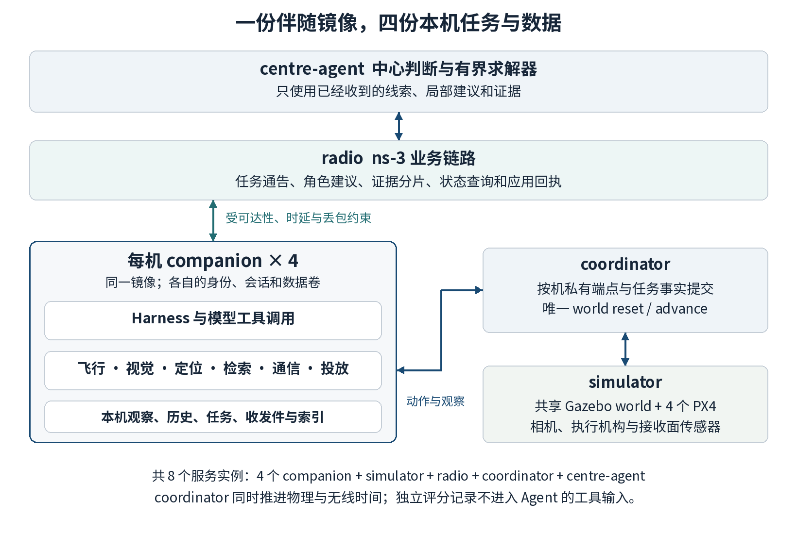

# AeroAgentSim 低空救援伴随计算机沙盒需求与验收规范

版本 1.0　编制日期 2026 年 10 月 17 日　实施目标分支 main

## 1 建设目标与完成定义

建设一个可安装、可启动、可复制到多架无人机的 Linux 伴随计算机镜像 `aeroagentsim/companion`。镜像内部实际运行 Agent、飞行客户端、相机接收、人员检测、目标定位、历史检索、证据处理和通信程序。四架无人机使用同一个镜像，分别拥有配置、任务、工作进程和本地数据卷；外部由现有 AeroAgentSim 调度器、一个共享 Gazebo 世界、各机 PX4 SITL 和 ns-3 服务支撑运行。

本次交付的业务范围是白天洪涝场景下的低空救援支援：执行原任务时发现或接收疑似受困线索，搜索与复核目标，定位并整理证据，判断能否参加救援，与中心和队友协同，建立中继，投送应急物资，核实交付，恢复原任务或返航。完成后应能在云电脑上从源码和锁定依赖构建镜像，用一套启动命令运行四机救援，用逐项证据说明各功能是否成功，再提交面向 main 的 PR。

**完成必须同时满足四件事。** 容器可以从明确来源构建并冷启动；每项具体程序在容器内真正执行；感知、飞行、通信和投放形成同一运行中的因果链；验收清单中的必需项均有本次运行证据。软件能 import、镜像能 build、工具返回一个成功 JSON、前端动画播放和常规 CI 通过，各自只能证明对应环节。

需求中的数值是本项目的初始工程验收目标，适用于本文指定的仿真配置和样本集合，不是已经测得的性能，也不是实机认证指标。夜间热成像、喊话、绞盘救人和水动力学具有不同硬件及建模前提，在第 15 节给出对应扩展条件；不能用本规范的白天物资支援结果代替这些能力。

## 2 当前代码基线与必须补齐的部分

### 2.1 固定审查基线

仓库为 `ZhiweiWei-NAMI/AeroAgentSim`。本规范核查的 main 提交为 `0b406d01f27920da45facd8d2d6cdde1e7c3d49e`，提交时间为 2026 年 10 月 17 日 00:38:14 UTC。仓库默认分支为 `dev/lowalt`，执行代理必须显式获取 `origin/main`，PR 的 base 也必须显式设为 main。实施时若 main 已前进，应阅读新增变更并记录实际起点，保留已完成的修复；不把仓库回退到本规范的审查快照。[S1][S24]

### 2.2 现状与增量

| 项目 | 当前代码已提供 | 本次必须完成的增量 |
| --- | --- | --- |
| 仿真后端 | PX4/Gazebo 和 ns-3 Dockerfile、原生服务、推进与记录接口 | 编排现有后端和每机 companion，形成可冷启动的 Compose 部署 |
| 飞行动作 | arm、takeoff、goto、hold、land、disarm 的排队和观察完成判据 | 把救援运动连接到 PX4；增加真实取消、抢占后 hold、后续任务恢复 |
| 救援任务 | 每机角色建议、中心任务图、能力和承诺约束、报告与回执 | 把角色建议前的实际检索、复核、代价计算放进每机软件；让任务消费真实结果 |
| 相机 | 浏览器渲染 PNG 和原生相机模型补丁 | 导出 Gazebo RGB、深度、CameraInfo、外参及时间；补 PX4 估计位姿 |
| 观察结论 | 到位后读取 authored observation | 用真实图像推理和证据复核产生结论，并保留不能确认的状态 |
| 物资交付 | 到点停留、扣载荷、生成 delivery_ack | 执行机构释放实体包裹，验证落点、载荷状态和接收证据 |
| 历史数据 | run 级共享 ArtifactStore | 每机独立的观察档案、索引、检索和接收副本 |
| 无线通信 | 真实 ns-3 Wi-Fi/UDP；报告与交付回执等待逐跳送达 | 对真实文件分块、重组、校验；将任务通告、建议、计划和应用 ACK 纳入受损业务链路 |
| 验证 | 单元测试、可选原生 smoke、离线回放 | 本次云机的安装、图像推理、动作、通信、投放和四机闭环证据 |

这些增量有明确源码依据。当前救援 `rescue.py` 在 717–719 行使用配置观察，在 721–725 行按停留后扣载荷；救援 materialize 仍接 kinematic 底座。相机通过 `observations/committed.py` 和 `renderer.py` 驱动浏览器获取像素，原生 PX4 RPC 尚未提供 RGB/深度。现有 Agent engine 的逻辑身份隔离，也不等于独立容器和本地文件系统。[S8][S10][S13][S15][S16][S17][S18]

默认 CI 排除了 Docker 和 live LLM，部分救援状态机测试会替换通信结果为已送达。继续保留这些测试的用途，同时增加本规范要求的实际运行；不能把历史 live5 记录或已有绿勾填入本次验收结果。[S20][S21][S22][S23]

## 3 部署组成与程序归属

### 3.1 一份镜像与多个运行实例

默认 Compose 包含八个服务实例：`simulator`、`radio`、`coordinator`、`centre-agent` 和 `uav-u1` 至 `uav-u4`。中心可复用同一 Python 包的独立入口，是否采用独立镜像 target 由依赖体积决定。它必须拥有独立上下文和收件目录。图形界面由 coordinator 提供，关闭界面后救援仍能运行。

| 服务 | 运行内容 | 持有的数据和职责 |
| --- | --- | --- |
| simulator | 一个 Gazebo world、四个 PX4 SITL、现有 patched MAVSDK server、传感器与载荷适配器 | 物理世界、飞控、原生采样；接受唯一世界所有者的 reset 和 advance |
| radio | 现有 ns-3 原生服务及业务传输适配器 | 无线包、逐跳时延和丢包；只在送达后交付业务内容 |
| coordinator | AeroAgentSim kernel、世界连接、按机路由、任务事实提交、界面与日志 | 推进共享时间；保持一个事实一个 writer；接入外部作业结果 |
| centre-agent | 中心模型连接、任务图建议与现有有界求解器 | 已收到的线索、局部建议和证据副本；不挂载各机原始历史卷 |
| 每机 companion | 本地 Harness、具体程序、作业管理器、收发件服务、观察索引 | 本机配置、传感器、任务承诺、历史、接收副本及运行日志 |



### 3.2 唯一世界所有者

现有原生 PX4 服务只接受一个世界所有者连接。由 coordinator 中现有 adapter 保持此连接并负责 reset/advance；每个 companion 通过新增的按机路由接口取状态、提交动作、收回执。companion 不单独连接共享服务执行 reset，也不独立启动一个 Gazebo 世界。四个窗口看起来同时运动，不能证明四机处于同一物理世界。[S3][S4]

仿真运行沿用现有 MAVSDK 服务位置。companion 内的飞行程序是实际可执行的客户端，它经 coordinator 将动作交给 MAVSDK/PX4。后续实机部署可将同一飞行适配接口接到本机串口或 UDP MAVSDK；本次不同时开发第二条实机链，也不再增加一个会争抢控制的 MAVSDK 所有者。

### 3.3 每机隔离与可共享内容

每机至少配置 `UAV_ID`、运行 ID、能力、传感器清单、飞行接口、业务消息地址、模型 profile 和本地目录。分别挂载 `/data/u1` 至 `/data/u4` 到各自容器内部 `/data`，内部包含 `observations`、`artifacts`、`index.sqlite`、`tasks`、`inbox`、`outbox` 和 `logs`。模型权重和公共静态地图可以只读共享，历史数据库、会话和未发送的图像不可共享。

默认由 coordinator 为每机创建独立 Unix socket 目录，每个 companion 只挂载自己的目录，容器内统一使用 `/run/aas-uav/agent.sock`。服务端由监听端点确定 UAV 身份，不接受请求体覆盖；等效的固定身份私有端点也可以，但须在 Compose 和路由配置中证明绑定。U2 的本地检索不得读出 U4 的原始文件；U4 显式发送并完成受损链路投递后，U2 才能检索已收到的副本。副本保留原 observer、采集时间和内容 hash。开发代理和独立评分程序拥有的调试视图，不属于机载 Agent 的工具权限。

新增 `native_companion` profile 时，停止当前 `rescue.expand()` 自动创建的 `rescue_uav_*` 和 `rescue_center` 决策 engine，改接外部进程事件桥。旧 LowaltTasks/Rescue 不再自行提交同一任务的运动、揭示 authored 观察或扣减载荷。中心提出任务图和分配版本，coordinator 提交任务事实，每机 worker 执行当前已接受的任务。全部动作经同一个 task_id/task_revision 检查，同机只有一个活动动作来源；原有 authored/stub 场景通过显式 profile 保留。[S10][S14][S18]

字段归属也要固定：现有 kernel/native adapter 持有物理状态投影的 writer；新增机载估计写入独立 `vehicle_estimate` 字段，不能覆盖同名世界真值；本机程序写观察和作业结果，coordinator 将结果提交为任务事实。评分真值不挂载到 companion 或中心。

## 4 软件选型与安装责任

### 4.1 默认软件栈

选择原则是复用现有可运行代码，并为每项缺失功能安装有明确用途的软件。默认不新建第二套仿真内核、全局状态库或通用插件框架。

| 软件 | 安装位置 | 在本项目中实际做什么 | 固定方式 |
| --- | --- | --- | --- |
| Docker Engine 与 Compose v2 | 云主机 | 构建和运行全部服务 | 记录实际版本及安装来源 |
| 现有 PX4/Gazebo/MAVSDK 组合 | simulator | 物理仿真、飞控、动作回执 | 保留源码指定版本并固定基础镜像 digest |
| 现有 ns-3.48 服务 | radio | 业务数据包的无线传输 | 固定原生源码、编译参数和镜像 digest |
| Python 3.12 与 AeroAgentSim 包 | companion、中心、coordinator | 工具进程、现有 provider/LangGraph 和服务入口 | 在 Ubuntu 24.04 伴随镜像内生成完整依赖锁 |
| Gazebo Transport 与 Messages | simulator 的 sensor adapter | 接收相机、深度、时间、模型执行结果 | 与现有 Harmonic 对齐；不在每机复制 Gazebo |
| OpenCV 与 NumPy | companion | 图像读写、裁剪、几何计算、投影和小规模向量检索 | 依赖锁，记录实际后端 |
| RT-DETRv2 R18 预训练模型 | 构建或模型准备阶段 | 导出真正的人员检测模型 | 官方源码 revision、权重 hash、导出配置 |
| ONNX Runtime | companion | 执行检测模型；CPU 默认，GPU profile 显式选用 | 锁定版本和 provider；GPU 做实际 CUDA 兼容检查 |
| Norfair | companion | 将连续检测关联为本机目标轨迹 | 固定版本；声明关联规则和相机运动处理 |
| SQLite FTS5 与 FastEmbed 小型中文 BGE | companion | 时间/空间/来源过滤、文字与语义检索 | 数据库独立；模型 revision 和 hash 固定 |
| 既有地理转换或 pyproj | companion 或坐标适配器 | ENU、ECEF 和经纬度转换 | 优先复用仓库转换；缺失时固定一条 pyproj 管线并校准 |
| HTTPX 与现有服务组件 | companion、coordinator | 管理接口和业务传输客户端 | 复用依赖，不另建消息中间件 |
| FFmpeg | companion 的可选视频工具或证据导出阶段 | 对需要的视频片段编码 | 图片裁剪压缩可先用 OpenCV；不用则不装入最小 runtime |

RT-DETRv2 官方实现提供 PyTorch 模型和 ONNX 导出路径，ONNX Runtime 提供相应执行后端。运行镜像只需要导出的模型及推理依赖；PyTorch、训练数据和导出工具放在模型准备阶段，不为每架无人机重复安装训练栈。[E07][E08][E09]

历史检索默认使用 SQLite 加 `BAAI/bge-small-zh-v1.5` 的 FastEmbed 路线，并用 NumPy 对本机候选向量做精确检索。FTS5 负责可检索文字，中文语义由嵌入和显式过滤完成，不能假定默认 tokenizer 已提供中文分词。初版不需要 Qdrant 服务或独立向量数据库；只有实测数据量导致查询达不到目标时才增加索引库。[E12][E13][E14]

| 已比较的方案 | 本版选择及理由 |
| --- | --- |
| 现有 Gazebo Transport 与 ROS 2 全栈 | 直接补现有 Transport 适配即可获得需要的数据；已有 ROS 算法确需时再加 ROS profile |
| RT-DETRv2、其他现成人员检测器 | 固定 RT-DETRv2 R18 与其官方权重/导出路径，先获得一个可复现基线；替换模型需记录许可、输入契约和留出集结果，不同时维护多套默认模型 |
| SQLite/本地向量与服务型向量库 | 每机文件和少量候选适合独立 SQLite；语义检索需要实际模型，增加数据库服务本身不会增加感知能力 |
| 现有 Harness 与新 Agent 平台 | 复用 provider/LangGraph，补作业、工具和按机状态；不借此任务重新开发通用编排产品 |
| 配准仿真 RGB-D 与直接使用现成相机模型 | 主场景需要下视和声明量程；现成 OAK-D 模型的朝向、视场和量程须逐项核对，不能按 RGB 坐标直接读取另一光学配置的深度 |

地理转换须记录实际调用的包和 API；不能因安装了名为 GeographicLib 的 Python 包，就认为具备同名 C++ 库的全部 LocalCartesian 接口。[E16][E17]

### 4.2 已核实的版本约束

现有 Dockerfile 要求 PX4 二进制包含提交 `381149fb012762f5e38c4a7fdc1b905b28038970`，版本字符串为 `v1.17.0-alpha1-1551-g381149fb01`；MAVSDK 为 3.17.2，源码提交 `9e3ca17faa84aa868caea10a3bbdab7e53810ced`，并带仓库内的心跳补丁。这是本次先复现的组合。`px4io/px4-sitl-gazebo` 当前未固定 digest，实施代理须解析并记录真正可用的 digest；若 tag 已漂移，应定位原镜像或按已知源码构建，不得删除版本断言后把另一个版本叫作基线。[S2]

新版 MAVSDK Python 已出现原生绑定与 gRPC 包名分离。不能一边无版本执行 `pip install mavsdk`，一边假定旧 `mavsdk_server`/asyncio 接口不变。沿仓库 requirements 和固定服务版本验证 imports、方法签名与遥测单位，再输出完整 lock；不借本任务同时升级 PX4/MAVSDK 主版本。[E25]

传感器优先使用现有 Gazebo Transport/Python 路径。ROS 2 Jazzy 与 Gazebo Harmonic 的集成可以作为需要 ROS 算法时的附加 profile；ROS 2、DDS、Nav2 或 BehaviorTree 不构成本项目的必装清单。现有 LangGraph/provider 可以复用，具体飞行、视觉和检索程序需要独立实现。[E04][E24][E27]

### 4.3 下载与运行分离

软件准备阶段产出 `software-lock.json`、Python 锁、模型锁和资产锁。每项记录官方地址、实际版本或 revision、SHA-256、安装命令、文件落点、许可证和实际验证命令。具体 revision 未在本规范提前确定的库，在目标云机成功解析后填写；`03_software_sources.json` 中的待解析字段不是已下载声明。

所有必需模型、Gazebo meshes、纹理和场景资源在启动前下载并校验。规则 Agent 模式在断开外部下载网络后能够冷启动；live 模式仅需要已配置的模型 API。运行过程中不依赖自动下载权重、临时拉取 Fuel 模型或临时 pip 安装。镜像通过构建后记录 digest；验收和 PR 引用实际 digest。

## 5 具体救援程序与 Skill

Skill 在这里表示一项有明确业务目的、能调用实际程序并返回证据的操作流程。每项提供短 `SKILL.md`、输入输出 schema、可执行入口和一个真实调用样例；若流程复用公共程序，入口可调用公共模块，不复制实现。Agent Skills 的目录规范可用于组织这些内容，目录检查只能验证格式，不能证明技能可用。[E23]

所有入口同时可被规则 Agent 和模型 Harness 调用。以下 19 项名称是需实现的接口契约，不是声称当前仓库已有这些命令。每项的工具层使用 JSON 请求和结果；长任务返回 operation ID，后续通过事件或查询获得进度。

### 5.1 搜索与视觉证据

| Skill | 实際调用的程序与输入 | 输出和可观察效果 |
| --- | --- | --- |
| `search-area` 区域搜索 | 区域多边形、允许高度、地图、相机视场、时间预算；航线程序加 flight 客户端和相机采集 | 路径、已实际观察区域、未覆盖区域、帧引用；飞机经过航点并产生新画面 |
| `detect-persons` 人员检测 | 本机 RGB 文件和检测模型；禁止读取实体真值表 | 框、类别、分数、frame_id、模型 hash；保存带框图和原始推理结果 |
| `track-persons` 连续跟踪 | 连续检测、时间及可用的位姿；Norfair 或明确的等价关联实现 | 本机 track_id、关联帧、位置变化及失跟状态；相机运动不直接当作人员运动 |
| `locate-target` 目标定位 | RGB 框、配准深度、K、外参、同刻 PX4 估计位姿 | ENU 位置、可选经纬度、不确定度及引用；无有效深度时给出不能定位的原因 |
| `verify-target` 换视角复核 | 当前候选、已有图像、局部地图和可用观察点 | 选择新观察点、真实移动、补拍并比较；结论为 confirmed、rejected 或 uncertain |
| `compare-observations` 新旧观察比较 | 两组已取得的证据、时间和目标关联 | 解释目标新增、移动、消失或遮挡的依据；不能把未看见直接解释为已离开 |

搜索覆盖率由实际采集时刻的相机投影与可见范围计算，规划航线经过某网格不自动算该网格已观察。连续跟踪仅建立匿名目标关联；不声称识别真实人员身份。复核至少包含一个与首次观察有几何差异的新视角，或由第二架无人机取得的独立新观察；重新运行同一张图片不算复核。

### 5.2 本机历史与证据加工

| Skill | 实際调用的程序与输入 | 输出和可观察效果 |
| --- | --- | --- |
| `retrieve-sightings` 历史目击检索 | 自然语言需求、时间窗、区域、类别和来源过滤；SQLite/BGE | 返回本机真实记录的 ID、时间、位置、得分和文件引用；重启后仍可查 |
| `package-evidence` 裁剪与压缩 | 原始帧、框/区域、最大字节预算、报告字段 | 实际 JPEG/PNG 或视频片段、manifest、hash、字节数；质量或预算不满足时明确反馈 |
| `read-evidence` 查看证据 | 本机 artifact_id 或已经收妥的副本 ID | 真实内容和元信息；不存在或尚未收到的文件不能用路径猜测读取 |

采集程序自动写入元数据和本机索引，模型不需要逐帧主动“记忆”。保留完整任务周期的关键帧、原始裁剪依据和检测记录；连续原始视频可以按明确容量保留滚动窗口，已进入事件证据链的文件不得随滚动清理。记录要区分 `observed_at` 与 `received_at`，查询“我刚才看到什么”和“队友刚发来什么”应返回不同集合。

`retrieve-sightings` 还支持按时间与相机观察区域取回当时没有检测结果的历史帧，并实际调用同一检测程序重新分析。保留原 frame_id、文件 hash、`observed_at` 与新的 `analyzed_at`，不把重分析伪装成新目击。中文文字嵌入不会自动理解从未分析的图像，这条回查分支必须真正读取旧图。

### 5.3 参与判断与通信协同

| Skill | 实際调用的程序与输入 | 输出和可观察效果 |
| --- | --- | --- |
| `estimate-assignment` 任务代价估算 | 当前位置、电量、载荷、现有承诺、实际可行路径和任务类型 | 最早开始/完成时间、额外航程、预计能耗、影响的旧任务和来源；未知值保持未知 |
| `offer-rescue-role` 提交参与建议 | 任务意图、相关本地证据、代价结果与能力 | 可以承担的角色、可用时间、条件与拒绝原因；形成实际发出的建议消息 |
| `probe-route` 探测通信路径 | 目标节点、允许中继、实际探测包和测量窗口 | 到达率、往返时间、所用路径及时间；不只读取配置的信号标签 |
| `send-evidence` 发送证据 | 收件方、真实文件/消息、优先级、期限 | 分片传输、接收重组与应用 ACK；只有收件 hash 匹配才返回交付完成 |
| `hold-relay` 建立并保持中继 | 中继候选位置、需保持的任务/文件、退出条件 | 飞至候选点、探测确认、逐跳转发；在接收完成或明确交接前保持角色 |
| `handover-role` 转交现场职责 | 当前职责、待办内容、已发/未发证据、接替候选 | 接替确认、任务版本和实际数据交付；旧机退出与新机接任可关联 |

参与建议必须能解释“为什么这架机现在能做/不能做”。payload 包含本机能力、电量/载荷、已有承诺及版本、观察时刻、有效期和候选动作的航段、时间与能量估计。电量来自明确的本机遥测或显式声明的仿真能量模型；若后者驱动低电变体，记录其来源和参数，不声称它是 PX4 电池实测消耗。未知值不填零，过期估计不继续沿用。

中心只从已收妥的本机摘要构造求解器输入，不能读取全场 `vehicles` 补齐缺失项。沿用现有小规模有界枚举，替换硬编码的直线距离/速度代价；同机顺序执行不同任务时使用相应“前序目标→后序目标”航段估计，不重复使用从当前位置出发的时间。缺少或过期的航段代价标为不可评估，重新请求或不分配。本版不增加通用全局规划器。[S11]

### 5.4 物资支援与任务恢复

| Skill | 实際调用的程序与输入 | 输出和可观察效果 |
| --- | --- | --- |
| `select-drop-site` 选择投放位置 | 已确认目标、允许投放区域、地图、当前相机/深度和人员位置 | 一个有证据的可用投放点或不能投放的原因；不能直接把人的位置当投放点 |
| `deliver-supply` 运输与释放物资 | package_id、投放点、载荷状态、航线及任务承诺 | 真实飞行动作、释放指令、挂载状态改变；返回运输和释放各阶段 operation |
| `verify-delivery` 核实交付 | 释放操作、执行机构状态、后续现场观察和接收记录 | released、observed_at_site、receipt_delivered 等分阶段证据；缺少关键证据时不输出 delivery_verified |
| `resume-or-return` 恢复任务或返航 | 剩余任务、当前位置、电量、充电点和角色释放回执 | 恢复原任务或执行返航/降落；保留未完成任务及其责任归属 |

起飞、到位、hold、取消、降落、读取遥测和相机采样作为公共底层程序供这些 Skill 使用，不将每个 RPC 都包装成新的业务技能。通信接收、入库与 ACK 由程序自动完成，不要求模型逐个处理网络分片。

## 6 观察数据与工具契约

### 6.1 最小观察记录

每个 `Observation` 至少含：`run_id`、`uav_id`、`sensor_id`、`frame_id`、采集来源、`source_time`、`source_clock`、`clock_epoch`、`available_sim_ns`、`received_wall_time`、坐标系、RGB/depth 文件引用和 hash、内外参版本、估计位姿及其时间、有效性状态。深度保存米制 float32 数据及无效掩码，另声明 `depth_convention=optical_z` 或 `ray_range`、无效值规则和 `target_reference`；展示图另存，不把彩色深度可视化当原始测距。

图像、深度和估计位姿必须对齐。RGB/depth 有独立分辨率、视场或安装位置时，先配准或通过外参投影；不能将 RGB 框坐标直接索引未配准的深度图。PX4 NED、机体 FRD、工程 ENU、相机 optical 和航向角分别声明。正常机载位置、速度、姿态必须来自本机可获取的 PX4 估计及已声明传感器；估计不可用时报告 unavailable，Gazebo 全局真值只进入独立评估。[S6][E03][E10][E26]

P3 默认经现有 MAVSDK 连接的 MavlinkDirect 获取带源时间的 `LOCAL_POSITION_NED`、`ATTITUDE_QUATERNION` 和需要的 `GLOBAL_POSITION_INT`；保存 `time_boot_ms`、PX4 实例及接收位置。若固定版本中另一条带来源时间的 Quaternion/Odometry 路径更直接，可在契约冻结时选择并证明。不要另绑定已被占用的 UDP 端口；仅增加没有采样时间的 PositionVelocityNed 字段不满足同步要求。[E38][E39]

每机记录 `px4_local_ned` 到共同 `world_enu` 的变换、各自初始化原点、全局坐标与高度基准，以及 PX4 boot clock/Gazebo clock 到当前 run 模拟时间的映射。每次 reset/restart 重建并版本化这些映射，处理原生 warmup 与 episode 零点的偏移；NED→ENU 轴交换不能替代原点转换，上一 epoch 的样本不得混入新 run。

默认仿真相机应配置为可观察屋顶的下视或可控倾斜 RGB-D，采用同一光学配置的配准输出；建议 RGB 为 1280×960、水平视场 80°、深度有效范围 0.2–60 m、采样 5 Hz。这里的量程属于本项目仿真传感器配置，不代表真实 OAK-D 等设备性能。实际配置、K、畸变和外参写入 asset manifest；模型权重的输入尺寸与相机原始分辨率分别记录。首次验证用实际输出的 CameraInfo/K 计算视场，不照搬代码里未生效的常量。

正常确认采用悬停拍摄。初始同步目标是 RGB/depth 时间差不超过 40 ms；匹配位姿与图像时间差不超过 40 ms，或者有覆盖该时刻的有效两侧源样本。插值的每侧时间差初值不超过 40 ms，保存真实样本时刻和跨度，并在所需样本实际可用后才发布结果。无法建立 source clock 映射时，此帧可以保留为视觉证据，但不得通过定位验收。不得将接收墙钟伪装成传感器采集时间。

### 6.2 工具请求和结果

同步结果包含 `request_id`、`tool_name`、`uav_id`、`status`、`observed_at`、输出内容和 evidence 引用。长任务另含 `operation_id`、`task_id` 和 `task_revision`，状态至少区分 accepted、running、succeeded、failed、canceled。`accepted` 只表示接收请求；动作、文件或任务的完成必须由后续观察产生。

`fly_to` 的提交结果示例是 `status=accepted, operation_id=op-17`。到达结果必须关联该 ID，并给出到位位置、速度、状态、观察时间与判据。`locate_target` 的结果应给出 `frame_id`、`detection_id`、`position_enu_m`、位置不确定度或误差来源，以及 K/外参版本；缺少深度时返回 `status=unavailable` 和原因，不生成 `[0,0,0]`。

工具 schema 从统一定义生成模型 tool schema、CLI 输入校验和 API 文档。它们使用同一业务函数，不维护三套实现。MCP 可以在后续接入需要它的客户端时封装同一函数，本次原生 tool calling 不以新增 MCP server 为前提。

### 6.3 图像检测与定位的真实输入

人员检测只读取 RGB。深度定位可以使用该机的深度传感器；真值 ID、实例标签、受困人数和作者 positive/negative 字段不进入 detector。独立 scorer 持有真值，用于计算漏检、误检和位置误差。分割真值如果用于生成训练标注，应作为数据准备流程记录，不能在验收推理阶段调用。

定位先对像素去畸变，令 `r = inverse(K) × [u,v,1]`；光轴深度用 `p_camera = z × r`，射线距离用 `p_camera = d × r / norm(r)`，再按声明的外参与同刻估计位姿转换。初版从框内保守 ROI 的有效近深度簇取样，保存像素、有效支持率和离散程度；框内背景占多数、前景无法区分或有效深度不足时返回 unavailable，不能查询实例真值来选簇。统一以可见人体表面采样点的水平位置作为检测定位参考，记录对应定义；人员间隔计算另计人体尺度及定位不确定度。纯几何反投影与“检测框→目标位置”分别评分。[E10]

RT-DETRv2 导出必须显式加载下载的训练权重。官方脚本在缺少 resume 时仍可能导出默认初始化网络，ONNX 结构检查也不检查检测能力。准备阶段应保存权重 hash、加载记录，并在相同图片上比较 PyTorch 与 ONNX 的类别、框和分数，随后实际运行容器内 ONNX 推理。[E08]

### 6.4 Harness 与本机进程

| 进程或模块 | 必须实际承担的工作 |
| --- | --- |
| agent 入口与既有 provider | 载入本机任务、近期观察和已收消息，调用规则策略或模型，解释 tool call；配置模型、上下文预算与墙钟超时 |
| 工具注册与 CLI 执行 | 暴露第 5 节业务流程和本地文件/程序入口；执行真正的 Python/CLI 函数，返回 stdout、stderr、退出码及产物引用 |
| 作业管理器 | 管理长动作和推理/编码任务，保存 operation 状态、取消、超时与重启对账；限制本机同类并发，避免重复控制同一架飞机 |
| 观察与收件 worker | 相机采样、索引写入、分片接收、重组和 ACK 自动运行；不要求模型每帧或每片主动调用 |
| 会话与记录模块 | 保存任务、承诺、消息、工具调用与可见模型输出；长历史存本机档案，压缩上下文时保留 ID、当前任务版本和未完成作业 |

新增模块可以位于 `src/aeroagentsim/companion/`，具体文件名由实施代理按仓库约定确定，并写入工具清单。每机工作目录是自己的 `/data`；程序输出、文件引用和错误均可检查。原生子代理负责在云机开发这些程序，运行中的每机 Agent 则使用已安装程序完成任务，两种角色不混为同一个进程。

新任务、重要新观察、队友消息、作业完成和期限事件触发下一轮决策；普通视频帧先由感知程序处理，不按 5 Hz 逐帧请求模型。相近事件可合并为一次本机决策。模型/推理超时按墙钟，飞行和无线业务期限按模拟时钟，日志同时保存两者。发生上下文压缩、模型错误或进程重启后，未完成操作仍可对账，不重复投放、不重放旧航线。复用已有会话/provider/LangGraph 能力，补齐这张表中的进程连接与状态存储。[S18][E24]

## 7 飞行执行与时间推进

### 7.1 接通现有命令链

kernel 层的命令名为 `adapters.px4_gazebo.goto`，native RPC 中才映射成 `goto_location`。当前 lowalt task 提交 `{entity,target}`，原生 goto 使用 `position_enu` 等参数。新增薄 motion bridge，或沿已有可配置参数映射实现适配；任务 owner 不再同时向 kinematic 和 PX4 写位置。已有 `logistics-px4.yaml` 可参考参数映射，但必须转为当前场景格式并实跑。[S7][S14]

沿用已有到位判据作为初始门槛：goto 在目标 2 m 内且速度小于 1.5 m/s，持续 1 个模拟秒；hold 速度小于 1 m/s，持续 1 个模拟秒；land 必须观察到着地并解除武装。机载到位/hold 结果必须使用 PX4 估计遥测和飞控状态；评估端另用真值报告真实误差，二者分别记录。现有 native 真值完成判据如为后端回归保留，不能冒充新的机载结果。[S3][S5]

保留仓库实际端口映射并输出实例表：索引 i 对应 MAV_SYS_ID=i+1、本地 MAVLink UDP 18570+i、SDK 目的 UDP 14540+i、gRPC 50051+i；业务 UAV_ID 与索引的映射独立声明。管理端口只在实际需要的位置开放，不用另一张官方默认端口表覆盖现有改写规则。[S3][S25]

### 7.2 可取消的长操作

现有 native 服务在同机有活动命令时拒绝新命令，hold 也会被拒绝。本次增加 cancel/supersede 路径。queued 命令取消后移出待派发队列，并保证不会在下一次 advance 发出；running 命令进入 cancel_requested，由同机控制 owner 走专用 hold/模式切换入口。结束或隔离旧 MAVSDK 请求的重试和迟到回调后，观察 PX4 模式及减速，才将旧 operation 置为 canceled。只取消 Python future 或改任务字符串不算取消完成；取消失败要给出当前模式和原因，新航线等待取消终态。[S5]

取消以当前世界状态执行。模型迟到回复和旧低层动作回调都不得重新启动已取消航线；保存为过期结果，并让当前 Agent 处理新的状态。C05 分别验证 queued/running，running 实测初始水平速度为 3±0.25 m/s、空载、无额外风，机型与加速度写入配置；5 秒目标从后端接受 cancel 开始计算，包含排队与实际制动。随后继续推进至少 5 秒确认旧目标没有复活。返航使用现有飞行原语组成明确路线，或新增经过验证的 PX4 RTL 适配；未实现的 RTL 不写入能力清单。

### 7.3 模拟时间与墙钟

保留现有 lockstep：由唯一 coordinator 推进物理时间，传感器采样和通信投递在明确的模拟时间边界出现；模型调用、下载、CPU/GPU 推理和编码同时记录墙钟耗时。等待新相机帧时，需要协调推进至下一采样边界，不能在冻结世界中无限等待，也不能在 sensor adapter 内偷偷 advance。[S3]

需要未来模拟时刻的飞行、新帧、制动或 ACK，必须先登记作业并返回 accepted/pending，当前决策回合随即让出执行，让 coordinator 继续 advance。后续边界收到作业事件后再触发下一轮。不得在尚未返回的唯一世界 RPC 或暂停中的模型回合里同步等待这些结果；使用 async 函数不自动解决单连接上的等待环。后台 worker 只提交结果，不直接写 kernel 事实。C00 包含四机同时请求下一帧且一机执行长动作的片段，证明时钟和结果都继续前进。[S4]

普通任务级命令优先使用已有 mission/action 路径；若实现必须使用 Offboard，持续 setpoint 和保活由飞行 worker 或既有 SDK 负责，不能依赖模型一轮一轮发指令。PX4 Offboard 要求持续的存活信号，必须验证模型调用延迟期间飞控仍正常工作。[E02]

本轮交付证明 lockstep 模式的功能闭环。记录 `sim_elapsed_s`、`wall_elapsed_s`、模型耗时和实测实时率；不能用暂停仿真后很短的 sim 时间宣称真实救援响应速度。实时异步部署可以后续另开运行 profile，不在本次同时重写 kernel。

## 8 通信与本地证据传输

### 8.1 必须经过无线模型的内容

完整救援 profile 中，任务通告、角色建议、计划及更新、现场报告、证据文件、中继交接和应用 ACK 都通过业务通信适配器，并受到 ns-3 的可达性、时延和丢包影响。现有可靠事件总线保留给仿真推进、容器管理和同机传感器连接；它不能向收件 Agent 提前开放尚未送达的业务内容。[S12][S19]

模型 API 可在任务环境中配置为远程服务，其访问延迟和故障单独记录，不把它算作机间无线业务。若后续要研究失联时本机独立推理，需要再启用并实测本地模型 profile，不能把云模型调用称为完全离线机载智能。

默认启动时四机处于声明的指挥覆盖内，先经同一 radio 链路收到任务通告和初始约束，再进入遮挡区域。起飞前允许下发“失联后按公开候选点探测并恢复链路”的本地策略，不预置最佳中继坐标。中心每阶段建议收集窗口初值为 10 个模拟秒，使用已收妥且未过期的建议规划；未回复表示未知，不等于拒绝，也不从全场状态补齐。建议不足时请求补充、调整中继或到期结束；迟到建议进入新任务版本，不无限等待全机回齐。

### 8.2 真实字节与接收回执

sender 必须先生成真实文件，再使用其实际长度传输。默认采用应用分片，建议每片数据不超过 1024 B，并记录消息头、总片数、序号、校验、优先级和期限。批量提交包可减少 RPC 开销，不能减少模拟的实际字节或把一个图片只记成一段短文字。

原生 ns-3 目前仅按长度构造包。本次默认沿其内容门控模式传递真实分片：内部保存不可被接收方读取的不可变 payload，只有对应原生 packet 的末跳 delivery 才向接收服务交付；也可扩展原生包承载字节。门控实现证明的是“实际文件交付由原生无线事件决定”，不能写成原始图片字节已进入 ns-3 packet buffer。每个分片记录文件/分片 hash→传输 attempt→原生 packet ID→逐跳 delivery/drop→末跳交付→重组→入库的对应链；包长计入实际分片头和数据。被丢弃的分片不能进入收件目录，接收方没有共享文件旁路。[S19]

receiver 按 message_id/file_hash 重组并校验全文件 SHA-256，持久入库后产生最终 ACK；缺片集合/位图通过 NACK 或状态查询返回，控制消息也经过受损链路。先用 probe 确认路径，再开始一次有期限的传输尝试，每片在该尝试内最多补发 2 次；路径恢复后可以发起一次有记录的新尝试，默认每消息总尝试上限为 2，且不得越过任务截止。没有路径时证据留在 outbox，不提前耗尽数据重试预算。

ACK/状态查询超时初值为 5 个模拟秒，单份证据传输期限初值为 120 个模拟秒，实际期限取它与剩余任务期限的较小值。这些计时、次数与业务任务期限写入同一场景配置，并在日志中保存开始、重试和结束时刻。

最终 ACK 丢失时，sender 状态为交付未确认，可经状态查询或重复提交取得确认；receiver 对相同 message_id/hash 重发 ACK，不重复入库或创建救援事件。不同阶段分别记录 packet delivered、文件收妥、报告被消费，重试按模拟时钟计时。接收端重启后可恢复已收片和已完成记录。模拟服务不可用时不得改用可靠 HTTP 并仍标记 radio 成功。

中继保持到端到端完成、任务取消或接替者确认。中继移动后要重新测路径；不能只因为 relay 到达预设坐标就断言链路恢复。指标至少分开记录业务有效字节、逐跳传输字节、重传字节、丢包、最终文件 hash 和端到端耗时。

## 9 物资执行与业务完成

Gazebo 世界中建立带质量、碰撞体和唯一 package_id 的包裹实体，初始挂载到指定运输机。释放程序将实际指令映射到可分离关节或明确实现的执行机构，产生挂载状态变化和自由运动。MAVSDK Gripper、PX4 gripper 支持和 Gazebo DetachableJoint 是可复用部件；不能仅凭这些部件各自存在，就假定它们已经连通。[E21][E22]

默认包裹为 1 kg，投放目标为独立划定的屋顶接收区域。投放点与人员实际间隔目标为 5 m，选点时根据当前图像/深度和定位不确定度增加余量，并扣除人体尺度、接收区边缘和落点散布范围；没有可行区域时明确拒绝投放。该值只服务于本仿真验收，实际装备投放程序需另外定义。运输机到位后才允许释放，不能通过修改 payload_kg 触发成功。

默认现场确认采用在屋顶接收面明确建模的 Contact sensor/TouchPlugin，由接收器程序读取目标 package_id 的真实接触事件，持续接触至少 1 个模拟秒后产生本地接收记录，再经 radio 发往中心。接收器绑定位于接收面的固定无线节点 `drop-receiver-1`，可复用地面节点代码但不能冒用另一位置的中心身份。程序位于 simulator 内的独立环境适配进程，不增加容器或评分服务；它不能读取全场位置或采用 scorer 的 in_zone 布尔生成回执。现场新照片另作视觉佐证，人员检测器不自动承担包裹识别。[E03]

交付保留释放指令回执、包裹分离状态、原始接触/现场记录、后续照片、中心收到的接收回执以及独立落点评分。评分程序用世界真值检查接收多边形与实际人员间距；包裹稳定初值为线速度小于 0.1 m/s、角速度小于 0.1 rad/s 持续 1 秒，等待上限 30 个模拟秒，不等浮点速度精确为零。评分状态不回灌 Agent。释放但无接触、接触但回执丢失、落到区域外各自保留不同阶段，均不能提前输出 `delivery_verified=true`。

任务终态区分 `completed_with_delivery`、`rejected_no_target`、`unresolved_evidence`、`unfulfilled_no_resource`、`expired` 和 `failed_execution`。阴性分支正确结束可以通过该分支验收；不确定分支需要补证据，仍不确定时保持 unresolved，并提供可供人处理的证据。不能继续把“对 uncertain 返回空计划”统计成救援完成。[S10]

## 10 场景与数据准备

### 10.1 主验收场景

以现有 rooftop-flood 的四机角色和受保护任务为起点，新建 `rooftop-flood-companion.yaml`，使用同一 world 内的 PX4 飞行。U1 保留原任务，U2 起初适合侦察，U3 起初适合中继，U4 携带物资；能力、位置和机号在变体中交换，调度不得硬编码 U2/U3/U4。保留公开的区域地图和任务描述，将隐藏人员位置、人数与真值标签移入只供 evaluator 使用的场景数据。[S9]

首个疑似线索可以来自任务通告中的区域或历史观察，不能把准确人员坐标、最佳观察位和必胜中继位直接作为 Agent 已知答案。U2 先搜索并取得图像，再检测、定位、换视角复核、整理并发送证据；中心基于实际收到的内容更新任务。U4 完成投放后，现场复拍和接收回执推动中心完成任务。U1 的原任务全过程保持独立状态。

人员存在、位置确认与救援需求是不同信息。主场景任务通告可明确“该区域已报告被洪水隔离并请求物资”，视觉流程负责找到并复核目标；不能仅凭 person 检测分数推断伤情或求救意图。没有需求来源的人员线索保留为待核实报告，不能自行生成当事人的回应。

原始 scene 允许在空中初始化业务机队；新 PX4 profile 应从明确的地面或屋顶起点启动，经过真实起飞进入任务，不能把业务坐标直接写成 PX4 已飞到。地图中的建筑与 Gazebo 碰撞几何、任务路由使用同一坐标配置。先实现可复现的小区域，再把相同接口用于更大城区。

P0/P4 冻结场景几何表：公开可飞区与建筑碰撞体、四机起点和朝向、初始通信覆盖、搜索高度、复核距离、投放高度、接收多边形及人员尺度。工程起点可用约 300×300 m 区域、屋顶上方 20–35 m 搜索、接收面上方 3 m 释放；最终值必须与量程、人员像素大小、碰撞余量和 5 m 实际人员间隔同时相容。数值如需调整，先在开发场景验证，再冻结留出验收配置。

候选生成采用可执行的简单规则：search-area 在公开区域做相机覆盖条带，并由既有合法路径模块连接；verify-target 在目标周围可飞范围产生有限观察点，优先选择与旧视线夹角至少 20° 且有路径的点；hold-relay 从公开可飞空间产生有限候选并实际 probe；select-drop-site 在允许接收区按余量收缩后选可行点。地图未知或候选不足时报告缺口，不读取隐藏的最佳答案。

事件账本以 event_id 隔离任务、证据、分片和回执。默认中心一次激活一个救援事件，同时接受至少一条第二事件线索入队并回复状态；C08 验证排队、期限与明确拒绝/转交，不要求本轮开发多事件全局最优化。

### 10.2 图像与场景资产

使用可渲染的人体、屋顶、遮挡物、包裹和水面资产。每项资产记录官方来源、版本/下载地址、许可证和 hash；禁止只画一个目标 marker 后声称人员识别。预训练 COCO 检测器未必能识别简化仿真人形；若识别失败，应改进合理的人形与相机配置，或用训练/开发集适配模型，再在分离的场景和视角上检查，不能转用真值接口补结果。

人体默认选择许可明确的 MakeHuman 核心导出资产或已逐项核实许可的 Gazebo 人形；社区服饰、Fuel 模型和外部纹理分别核对。Gazebo actor 可作为视觉目标，但其动画不自动提供重力与碰撞；需要物理作用的包裹、屋顶和障碍必须有实际碰撞体。屋顶与包裹可自建 SDF 几何，纹理可选择许可明确的 ambientCG 项目，不依赖运行时在线资产。[E30][E31][E32]

SeaDronesSee 适合水面人员与船只的检测评估，FloodNet 适合洪涝语义分割，VisDrone 可补充陆地航拍小目标。默认选择 SeaDronesSee Object Detection v2 的可复现子集，明确其 swimmer、boat、jetski、buoy、life saving appliance 五类与 COCO person 的评估映射、忽略类和负例规则。记录原始样本 ID，按独立视频/场景划分，避免相邻帧泄漏；VisDrone 有学术/非商业使用条件，按实际用途决定是否下载。SeaDronesSee 不能直接证明屋顶救援，FloodNet 的类别也不能代替人员检测。[E18][E19][E20][E35]

至少保留三套分开的成绩：真实图像检测；仿真 RGB-D 定位；多机业务闭环。真实图像集合建议不少于 200 帧并包含至少 50 帧无目标或易混淆场景；场景匹配的仿真人员检测测试另含至少 30 个独立观察时刻、不同视角及遮挡。需要训练时，训练/开发数据与这两套验收数据分开。结果报告说明检测框匹配 IoU、阈值、precision/recall、漏检样本和位置误差，不能只给几个好看的例图。

## 11 云电脑实施顺序

所有阶段先执行相关工作，再记录结果。相邻领域可并行；世界/动作/时间契约先统一，再接感知和业务，避免各代理各自实现协议。以下 `tools/` 脚本和 `deploy/compose.yaml` 是本次要求新增的交付物；第 11.2 节标明的现有命令除外。

### 11.1 P0 检查目标环境与记录基线

检查云电脑系统、CPU 架构、可用 CPU/内存/磁盘、Docker daemon、Compose、GPU及驱动、容器 GPU 可见性、软件源访问和已运行服务。只输出与构建有关的信息，不输出密钥。保存 `host-report.json` 和 `baseline.json`。建议起点为 Linux x86_64、16 vCPU、64 GB 内存、100 GB 可用空间和可用图形 GPU；这是四机开发的资源起点，不是性能保证，实际配置和峰值必须记录。

先读取目标 checkout 的 AGENTS.md、CONTRIBUTING 和相关目录规则，创建工作分支，记录工作树与已有服务。复用可用的 Docker 环境，避免在不支持的云容器中再嵌套 privileged Docker。如果当前宿主不提供可用 daemon，完成源码与依赖准备并留下明确阻塞信息；镜像构建项保持未完成。

软件缺失且目标环境允许安装时，按官方 Ubuntu 流程安装 Docker Engine 和支持该配置的 Compose plugin；已安装则复用并记录版本。NVIDIA 路径在宿主安装或复用驱动与 Container Toolkit，由 Toolkit 配置 Docker runtime；驱动不写入 companion Dockerfile。构建并行数根据实际内存与 CPU 配置，不固定沿用 `--parallel 16`。Ubuntu 24.04/Python 3.12 是新 companion 的默认，不要求原 simulator 镜像改成相同系统。[E05][E06]

### 11.2 P1 原样复现原生后端

先运行现有 `containers/px4-gazebo/build.sh`、`containers/ns3/build.sh` 和各自 smoke。PX4 用一个 cadence `--step-ms 20` 完成单机，再验证多机共享 world；不先做大量步长组合。使用独立命名的测试容器、只清理本次创建的资源，保存 native 日志及 smoke 输出。

现有 PX4 入口示例：

```bash
containers/px4-gazebo/build.sh
docker run -d --name aas-rescue-baseline-px4 \
  --cpus 16 --memory 16g -p 127.0.0.1:19000:9000 \
  aeroagentsim/px4-gazebo:standalone
python containers/px4-gazebo/smoke.py \
  --port 19000 --vehicles 1 --runs 1 --step-ms 20 \
  --output runs/acceptance/baseline-px4.json
```

运行前由脚本创建输出目录，并确认端口没有被其他任务占用。该示例验证现有后端，不验证 companion、救援、传感器或投放。保留现有成功链路后，再修改相机与执行机构。

### 11.3 P2 建立镜像与按机连接

新增 companion Dockerfile、依赖准备脚本、同镜像不同配置入口和 Compose。先导出动作所需的本机 PX4 基本估计位置、速度和飞控状态，连接一机真实动作，再复制为四个实例，核对私有端点、数据卷和命令路由。实现并运行 cancel→hold→下一任务；P3 再完成源时钟、原点与相机对齐，不能以 P2 的基本连接替代定位来源验收。此阶段停用 native_companion 中旧决策 engines，选择规则中心与规则每机 Agent，两者均不构造远程模型 client；不能只替换端侧后仍让中心调用模型。

### 11.4 P3 接入真实传感器和坐标

补原生 RGB/depth/CameraInfo、PX4 估计位姿、源时钟关联和按机导出。Gazebo 采用 OGRE2，服务入口明确使用 `gz sim -s --headless-rendering ...` 的 EGL 路径。NVIDIA 仿真容器开放 `graphics,utility`，若同时运行 CUDA 再加入 compute；仅有 nvidia-smi 或 compute 能力不能证明相机可用。无桌面 EGL 不依赖 DISPLAY/X server，CPU/Mesa 路径只有真实 RGB-D 验收通过后才可标为可用。[E28][E29]

保存四机真实样本，验证运动会改变画面；四机同时等待新帧时 coordinator 仍能推进。核对 ENU/NED、两个不同 spawn 原点/朝向、reset 后的 epoch、相机外参与 optical_z/ray_range。按固定校准样本完成来源与几何检查后，再接人员检测/定位；旧后端 smoke 没有传感器 GPU 参数不代表新增 sensor profile 已通过。

### 11.5 P4 安装感知与历史程序

下载检测和检索模型，导出并验证真正加载的权重。实现检测、跟踪、定位、复核、观察索引、历史检索和证据压缩。先对已保存的真实文件运行，再接在线帧；在线与离线用同一代码。模型确有域差异时，只做针对当前人员检测的适配，不扩成新研究训练项目。

### 11.6 P5 接入业务无线传输与物资执行

通信和载荷可以由不同代理并行完成。通信先验证小文本，再传真实图片，制造直传失败、中继成功、必需分片丢失和最终 ACK 丢失，逐项核对门控关联、补片、hash 与去重。载荷先单机空载/挂载/释放，再接收接触事件并通过 radio 发回，核对独立落点评分和现场照片。此阶段完成之前，不修改救援 outcome 为成功。

### 11.7 P6 接通每机 Harness 与中心规划

把具体程序注册到本机 Harness，接入事件、长作业和持久状态。规则中心和规则每机 Agent 根据真实输入先跑完整搜索—复核—通信—投放—回执链路，模型 API 调用数为零。随后同一工具集接 live 模型，至少真实运行一个完整正例和一个需要改变原计划的分支；模型调用失败应报告失败/重试结果，不自动换成规则决策并继续统计 live 成功。中心沿用 `propose_plan` 和有界求解器，输入改为收到的局部摘要及航段估计。端侧学习式参与过滤器仅作为后续可替换策略，不要求本次重新训练或依赖不可取得的旧权重。

### 11.8 P7 执行场景验收与修复

按第 12 节的固定案例运行，一份 run 可以覆盖多项需求。失败时保留输入和产物，定位到具体程序、数据、时间或适配问题并修复，再重跑受影响案例。只有改变公共动作/时间/通信契约时才重跑相关贯通案例；不为文案、样式或配置说明扩写大量测试。功能目标和通过阈值不能在失败后被静默降低。

### 11.9 P8 冷启动 复核与提交 PR

从干净构建上下文和锁定依赖重新构建，使用新 run namespace 与新的空数据卷启动，保留此前成功和失败 run 的证据。完成主闭环及离线回放，导出镜像 digest、证据索引、逐需求状态和运行说明。与实现代理不同的代理检查原始帧、动作终态、通信字节和物资落点，再检查 PR diff 是否含无关重构或旧行为回归。只清理已导出证据的本次临时资源，提交面向 main 的 PR，不自动合并。

## 12 场景案例与通过条件

只围绕实际风险运行少量贯通案例，不按工具数量机械创建上百个同构测试。每个案例记录 seed、输入配置、提交 SHA、镜像 digest、时钟和资源测量。主闭环跑 seed 42、43、44；其余分支先各跑一个固定 seed。案例判定与任务终态分别记录：正确报告“资源不足”可通过该失败分支验收，但不计作物资救援成功。

| 案例 | 实施内容 | 必须看到的结果 |
| --- | --- | --- |
| C00 基础运行 | 冷构建、后端 smoke、四机身份、起飞到位降落 | 同一 world、真实遥测及回执、镜像和版本可追溯 |
| C01 完整救援 | 四机、受保护旧任务、真实人员、需要中继、实体物资 | 本地图像→检测定位→复核→证据收妥→分配→释放→现场确认→中心 ACK；旧任务保留 |
| C02 阴性与不确定 | 无人员；另一次遮挡导致首次不确定 | 阴性不误投；不确定后补观察，仍不足则 unresolved |
| C03 链路中断与恢复 | 直传阻断、中继可通、图片分片丢失与重传 | 无提前可见文件；实际 hash 一致；ACK 走链路；中继退出条件成立 |
| C04 角色条件变化 | 受保护承诺、可用机更换、低电或载荷不足 | 参与建议依据更新；不强占受保护任务；替代机和新任务版本正确 |
| C05 长动作取消 | queued 和 running 取消，hold 后新任务；模型与低层回调迟到 | 飞机实际减速；旧操作 canceled；继续推进后旧目标不复活 |
| C06 历史与目标变化 | 多次观察、移动目标、重启、跨机证据；重看未检出旧帧 | 正确时空记录和实际重分析；遮挡不等于离开；只检索本机或收妥副本 |
| C07 投放异常 | 未释放或落点在接收区外；另设确认消息丢失 | 不能报 delivery_verified；保留实际阶段，允许补拍/补发或任务失败 |
| C08 新事件与期限 | 一活动救援中出现第二条线索；资源不足或截止 | 独立事件入队并回复；无跨事件串单；超时和无资源终态准确 |
| C09 回放与依赖 | 运行镜像禁外部下载；停止模型后回放 | 规则闭环可启动；回放零新模型、零新物理和相机调用 |
| C10 图像与几何 | 固定真实图像子集、仿真视角、三十个定位样本 | 图像推理真实；输出错误样本和指标；定位误差由独立 scorer 计算 |

### 12.1 初始数值目标

| 项目 | 通过条件 | 适用范围 |
| --- | --- | --- |
| 身份与路由 | 四机无串控；本地文件未经传输不可跨机检索 | C00/C06 |
| 单机动作 | 沿第 7 节到位/hold/着地判据；接受取消后 5 个模拟秒内满足实测 hold | C05 以 3±0.25 m/s 初速、空载、无额外风验证 |
| 时间同步 | RGB/depth 与对应估计位姿时间差各不超过 40 ms，或有效插值覆盖 | 用于定位的样本 |
| 仿真定位 | 预锁不少于 30 个适用样本；有效输出率≥90%；有效输出水平误差中位数≤2 m、P95≤5 m | 分母固定；含视场边缘、不同距离/屋顶、至少两机原点和一次 reset |
| 场景人员检测 | 匹配 IoU≥0.5，precision≥0.90、recall≥0.85 | 与主场景一致且留出的至少 30 个观察时刻；阈值在开发集锁定 |
| 真实图像检测 | 公开实际 precision/recall、类别映射与漏检图；不预先承诺通用分数 | ≥200帧的固定外部数据子集，单独报告 |
| 历史检索 | 20个有答案查询中 top5 命中≥18；5个无证据查询不编造；另实际重分析一份未检出旧帧 | 含中文；保留原始 hash、观察与分析时间 |
| 证据传输 | 收件文件 hash 100%一致；未到片不可见；无路径时不得有成功应用 ACK | C03 的真实图片文件 |
| 实体投放 | 真实脱离、接收面持续接触≥1秒、回执送达；独立评分稳定落点及人员间距 | 稳定阈值与30秒等待上限见第9节；C01/C07 |
| 正例闭环 | seed 42/43/44全部完成必须阶段；每例模拟截止初值900s | 限本文小区域和模型配置，不推断总体成功率 |
| 活性和资源 | 四机连续运行30个墙钟分钟无进程崩溃/无限等待；记录峰值内存、CPU/GPU和耗时 | 可结合C01和重复任务运行，不另造压测框架 |

定位报告列出全部适用样本数、检出匹配数、定位尝试数、有效输出数和每类 unavailable 原因，检测失败不能从定位覆盖率分母中删除。适用条件（可见性、距离、传感器量程等）和样本 ID 在运行前锁定，几何反投影与端到端检测定位分别报告。

上述条件不允许靠删除困难样本、只挑成功 seed、改用 authored 真值或隐藏失败满足。若依据验收样本调整模型、资产或相机，这些样本已成为开发材料；保存其结果并增加另一份预先冻结、未用于调整的验收集合。单纯修复确定的转换/通信 bug 可在原案例复跑，同时保留失败证据和修改理由。

## 13 原生子代理协作与仓库交付

总代理负责锁定契约、合并工作、运行贯通案例和提交 PR；子代理 01 负责容器、共享世界桥和飞行动作；子代理 02 负责传感器、视觉、定位与本机历史；子代理 03 负责通信、物资、救援 Harness 和运行证据。子代理之间在契约确定后并行，避免共同修改同一个文件；同文件改动由总代理分阶段合入。

第一轮交叉检查由 01 检查 02 的来源/时间/坐标，02 检查 03 的真实证据和投放，03 检查 01 的多机连接和回执；第二轮由总代理检查完整 run。发现实际缺陷后才增加针对性复核，不为了形式固定重复三次全套测试。

建议交付目录包括 `containers/companion/`、`deploy/`、`src/aeroagentsim/companion/`、`skills/`、`tools/`、新增场景和 `docs/guides/rescue-companion.md`。沿现有项目约定调整路径可以，但须在任务记录中建立一一映射。现有 motion、任务、日志和 provider 应复用；不复制整个工程另起 demo。

必须新增的操作入口如下，具体名称可以在实施前映射到仓库既有 CLI，但交付说明必须给出最终真实命令。

```bash
./tools/check-host.sh --out runs/acceptance/host-report.json
python tools/prepare_assets.py --lock deploy/assets.lock.json
docker compose -f deploy/compose.yaml build
docker compose -f deploy/compose.yaml up -d
python tools/run_case.py --case C01 --seed 42 --agent rule --attempt a1
python tools/run_case.py --case C01 --seed 42 --agent model --attempt a1
python tools/verify_run.py --run runs/acceptance/C01-42-rule-a1
python tools/verify_run.py --run runs/acceptance/C01-42-model-a1
python tools/export_evidence.py --run-root runs/acceptance
```

`verify_run.py` 读取原始记录和产物计算通过状态，不接受被验程序自己填写的 success 作为唯一依据。它应保持为小型、可阅读的检查脚本，复用现有日志查询；不为本任务建立新的签封、审计服务或泛化测试平台。

run_case 输出真实 run_id，至少含 case、seed、agent mode 和 attempt，变体另加 variant；已有目录必须拒绝覆盖。证据导出保留失败尝试与后续修复关系，不能用第二次运行覆盖第一次后只剩绿勾。

## 14 验收记录与 PR 完成标准

执行包中的 `02_acceptance_matrix.csv` 是逐项核实台账。初始全部为 `NOT_RUN`，实施代理填写 `PASS`、`FAIL` 或 `BLOCKED`、实测值、run_id、源码 SHA、证据路径及复核者。只有正常完成对应命令并具备证据时可置 PASS。构建成功但没有模型、GPU或原生运行的项目，不得跳过后并入已完成数量。

一个 run 的证据至少包含：运行配置与版本；各机实际收到的任务和模型可见上下文；工具请求、返回、异步状态；RGB/depth/K/位姿和检测输出；检索命中及源文件；实际发送/接收文件与网络事件；PX4动作与原生日志；包裹状态和现场复拍；中心最终结果；CPU/GPU、内存、耗时、token用量可得部分及缺失说明。模型日志保存可见输出和工具调用，不要求内部思维过程。

评分真值和 Agent 输入分别保存，evaluator 不把标签回灌给 Agent。原始资料较大时存入明确的运行制品目录或可下载 release/artifact，PR 给出稳定地址、大小和 hash；不要把所有原始图像塞进 Git，也不要只留下会失效的本机绝对路径。仓库内保留最小演示样例、复现命令和逐项摘要。

PR 说明按实际结果回答五个问题：本次补齐了哪条缺失链；修改了哪些现有模块；在什么云机/镜像/场景下运行；哪些需求及案例通过；哪些仍未通过及其真实原因。完整目标通过时提交可审查 PR；存在阻塞时可提交明确的 draft PR 并附剩余项，不把部分交付写成全功能完成。未经后续明确要求，不自动合并。

## 15 后续场景的增配条件

| 业务扩展 | 需要增加的真实能力 | 能力成立的证据 |
| --- | --- | --- |
| 夜间或烟雾搜索 | 热成像/红外传感器配置、对应模型和数据 | 真传感器图、配准、夜间样本和漏检评估 |
| 喊话与接收回应 | 音频/扬声器或消息终端、识别程序及双向通道 | 实际输出和收到回应；不是模型自行补写对方答复 |
| 水面投放 | 浮具、浮力/水面或明确近似模型、回收/接收规则 | 物体与水面的真实模拟作用及目标区域确认 |
| 实时自主避障 | 机载深度/LiDAR、局部建图、避障控制和持续执行 | 移动物体/临时障碍下的真实轨迹与碰撞记录 |
| 真实硬件飞行 | 实机相机、定位与 PX4 接口、执行机构标定 | 同一 Skill 接口在真实传感器和执行器上的独立验证 |
| 学习式参与判断 | 可取得且有训练来源的过滤器/轻量模型 | 与规则使用同一输入及证据，单独报告任务效果和开销 |

这些扩展使用同一套具体程序接口、任务状态和证据结构。主线首先完成已经定义的洪涝低空支援范围，后续按新增任务的传感器和执行条件增加功能。

## 16 逐项需求与证据索引

以下 `REQ-` 开头的是 requirement_id，共 50 项；C00–C10 是场景 case_id；正文方括号中的 S/E 编号是资料来源。三类编号分别用于功能验收、案例运行和引用核查。

| 需求 | 通过条件 | 案例及证据 |
| --- | --- | --- |
| REQ-D01 正确仓库与main基线 | 显式基于origin/main，记录实际SHA与工作树；PR base=main。 | C00；baseline.json; git diff摘要 |
| REQ-D02 目标云机与资源 | 实测daemon/Compose、系统与资源；缺失时按官方安装流程处理；GPU profile实测OGRE2/EGL及容器graphics能力，不以nvidia-smi代替出图。 | C00；host-report.json; host-check.log; effective-build-jobs.json |
| REQ-D03 软件与资源锁 | 保留已核实PX4/MAVSDK组合；依赖/权重/资产均有来源、revision、hash和实际文件。 | C00；software-lock.json; assets.lock.json; build.log |
| REQ-D04 可重建镜像 | 干净构建成功；以新run和新空卷冷启动，必需模型/资产本地可用；runtime不下载依赖，旧run证据保留。 | C00, C09；image-inspect.json; cold-start.log; run-volume-map.json |
| REQ-D05 共享世界与八服务编排 | 四机同一world/partition；只有coordinator持有reset/advance；每机独享固定身份Unix socket，外部工具不能取得完整world RPC。 | C00；compose.config.yaml; process-map.json; world-map.json; socket-map.json |
| REQ-D06 每机数据隔离 | 同镜像四实例独立会话/历史；服务端由私有socket绑定身份，伪报其他uav_id不能串控；未发文件跨机不可查，合法收妥副本可查。 | C00, C06；volume-map.json; socket-map.json; isolation-results.json |
| REQ-D07 退出与重启 | 仅清理本次创建且已导出的临时资源；原run历史可恢复；新run采用新空卷且保留旧证据；case/seed/mode/attempt组成唯一run_id，拒绝覆盖。 | C06, C09；lifecycle.log; before-after-index.json; run-registry.json |
| REQ-F01 救援实际使用PX4 | companion任务worker为同机唯一动作owner；救援经kernel goto到native goto_location；旧engine/kinematic/作者观察/扣载荷路径在此profile停用。 | C00, C01；action-route.jsonl; native.log; resolved-scenario.yaml; resolved-engine-map.json |
| REQ-F02 动作完成证据 | accepted与完成分开；Agent位置/速度/姿态及动作完成使用PX4估计和飞控/本机设备状态，禁止真值回退；第7节起飞/到位/hold/着地判据有源证据。 | C00, C01；operations.jsonl; estimated-telemetry.jsonl; flight-state.jsonl; evaluator-action-errors.json |
| REQ-F03 真实取消与hold | queued取消后永不派发；running从后端接受cancel计时，在固定3±0.25m/s空载无额外风配置下5sim s内实测hold；旧模型及低层请求/重试/回调不能使旧目标复活。 | C05；cancel-trace.jsonl; queued-dispatch-log.jsonl; low-level-callbacks.jsonl; trajectory.csv; effective-flight-config.json |
| REQ-F04 可行搜索和运输路径 | 共用公开地图生成可行航段、覆盖和候选视点；记录实际观察覆盖/未覆盖；投放选点纳入人员定位不确定度，不能用隐藏最佳点或穿建筑直线。 | C01, C08；routes.json; coverage.geojson; viewpoint-candidates.json; drop-site-check.json; trajectory.csv |
| REQ-F05 唯一时间推进与双时钟 | 唯一coordinator推进；跨模拟时刻请求先返回pending并yield，不能占住advance连接；每次reset/restart重建源时钟映射并隔离旧epoch。 | C00, C03, C05, C10；clock-map.json; sample-timeline.csv; decision-yield-trace.jsonl |
| REQ-F06 本机状态和代价来源 | 本机摘要含来源时刻/有效期、能力/载荷/电量/承诺；提供当前点及前序目标至候选目标的逐航段时间/能耗估计；缺失或过期保持unknown。 | C01, C04；self-state.json; leg-cost-report.json; commitment-version.json; assumptions.json |
| REQ-O01 原生RGB与数值深度 | Gazebo实际以OGRE2/headless-rendering在无DISPLAY下产生四机RGB/float32深度/K；真实移动后有新帧，CPU/Mesa回退也须实际通过。 | C00, C10；four-uav-rgb; depth.npy; camera-info.json; effective-render-command.json; renderer.log |
| REQ-O02 估计位姿与真值分离 | 机载定位必用本机PX4估计；保存带源time_boot_ms的MAVLink位置/姿态、每机local原点到world ENU及高度基准；真值只给独立evaluator，不静默回退。 | C10；raw-mavlink-estimates.jsonl; estimated-pose.jsonl; per-uav-origin.json; scorer-inputs.json |
| REQ-O03 坐标与深度配准 | 明确ENU/NED/FRD/optical、每机平移原点/朝向、内外参、depth=optical_z或ray_range及反投影；配准后按有效目标深度簇取值，背景/多簇不明时不可用。 | C10；calibration.json; registration-overlay.png; selected-depth-pixels.json; geometry-results.csv; reset-origin-check.json |
| REQ-O04 采样时间对齐 | RGB/depth与PX4估计源时刻差各≤40ms或有两侧有效且有界插值；记录实际源消息/boot-to-sim映射；禁止接收墙钟冒充源时刻或混用reset前样本。 | C10；sync-report.csv; raw-mavlink-estimates.jsonl; clock-epochs.json; interpolation-brackets.json |
| REQ-O05 检测模型实际加载 | 下载锁定训练权重并显式导出；10张图实际比较PyTorch/ONNX类别/框/分数；保存预处理、模型输入尺寸和类别映射，禁止随机初始化导出冒充模型。 | C10；model-lock.json; export.log; equivalence.json |
| REQ-O06 人员检测与位置指标 | 固定留出场景IoU≥0.5时P≥0.90/R≥0.85；预先锁定适用定位样本≥30且有效输出率≥90%，有效输出水平误差中位≤2m/P95≤5m；全量分母/检出/尝试/不可用原因公开。 | C10；frozen-evaluation-manifest.json; detection-metrics.json; localization-all-samples.csv; localization-summary.json; error-gallery |
| REQ-O07 跟踪与换视角复核 | 关联真实连续帧并处理相机运动；复核有几何不同的新frame/新视点，不能复用同图冒充新观察；遮挡不直接判人员离开。 | C01, C02, C06；tracks.jsonl; review-pairs.json; viewpoint-trace.csv |
| REQ-O08 缺图和无效深度 | 相机失效、过期帧、背景深度混淆及超量程明确unavailable；旧图只能标为历史证据，不冒充新图；禁止返回零坐标成功。 | C02, C10；invalid-observation-case.json; depth-selection-failures.json; tool-errors.jsonl |
| REQ-M01 持久本机观察档案 | 自动保存本机帧含无检测关键帧、来源/hash/观察足迹和检测任务；分别记录observed_at/received_at/analyzed_at，重启后可读且原证据不被覆盖。 | C06；index-summary.json; observation-manifest.jsonl; restart-history-check.json |
| REQ-M02 时空与中文语义检索 | 20个有答案时空/中文语义问题top5≥18，5个无证据问题不编记录；文字检索严格过滤，原始帧可按时间/观察足迹查回，不假定BGE理解未描述图像。 | C06；queries.json; retrieval-results.json |
| REQ-M03 真实证据裁剪压缩 | 从可追溯原图生成可解码文件，实际字节不超过请求预算，hash与manifest对应。 | C01, C03；evidence.jpg; evidence-manifest.json; encoding.log |
| REQ-M04 新旧证据比较 | 含一个原先无检测记录的旧帧：按时空取回原文件并实际重新分析，保持原frame/hash和observed_at，另记analyzed_at；新旧比较有依据，ID带observer范围。 | C06；comparison.json; historical-reanalysis.json; referenced-frames; observation-analysis-times.csv |
| REQ-C01 全部救援业务过无线链路 | notice/bid/plan/report/file/handover/ACK都经ns3；C01初态在指挥覆盖内经radio送达初始任务及U3预授权恢复策略，后续无可靠业务旁路。 | C01, C03, C04；message-ledger.jsonl; channel-map.json; initial-radio-task-receipts.json |
| REQ-C02 真实文件字节和分片 | 真实分片及协议头计入字节；源chunk hash→原生packet/attempt→逐跳事件→末跳delivery→receiver commit可追踪；丢片内容不暴露，门控方案不冒称原字节在native包内。 | C03；sent-file; immutable-payload-manifest.json; packet-ledger.jsonl; last-hop-delivery.jsonl; receiver-commit.jsonl |
| REQ-C03 接收重组和应用ACK | receiver全文件SHA-256校验并持久入库后才最终ACK；缺片NACK/状态查询及ACK都走radio，超时5sim s；ACK丢失后重复确认不重复入库或创建任务。 | C01, C03, C07；received-file; reassembly.json; nack-status-trace.jsonl; ack-trace.jsonl; dedup-results.json |
| REQ-C04 中继有效及保持 | 实际probe证实path ready；U3用已无线送达的预授权策略搜索候选位而非预置最佳点；中继保持至端到端确认/取消/合法交接，移位重新探测。 | C03, C04；probe-results.json; preauthorized-relay-policy.json; hop-trace.jsonl; relay-state.jsonl |
| REQ-C05 分片恢复与幂等 | 先probe确认path ready；每attempt内每片补发≤2次，路径恢复可新attempt但全消息总attempt≤2；ACK/查询5sim s，证据deadline≤120sim s且不越任务截止；outbox持久、接收幂等。 | C03, C07；retry-log.jsonl; attempt-counter.json; missing-chunk-state.json; dedup-results.json; outbox-recovery.json |
| REQ-C06 无链路时不伪造成功 | 无有效路线时保持pending/失败，不产生新的完整收件或成功ACK；不改可靠HTTP/共享文件；缺失bid保持unknown而非从全局状态补齐。 | C03, C08；no-link-case.json; inbox-before-after.json |
| REQ-P01 包裹物理实体 | 唯一package_id，1kg质量/碰撞/初始真实挂载；接收面是明确的物理碰撞几何和Contact sensor/TouchPlugin，作用范围与普通屋顶区分。 | C01, C07；payload-sdf; receiver-sdf; initial-payload-state.json; sensor-topic-map.json |
| REQ-P02 释放真实生效 | 命令驱动执行机构或DetachableJoint；包裹脱离机体并自由运动。 | C01, C07；release-operation.json; joint-state.jsonl; payload-trajectory.csv |
| REQ-P03 交付后置条件 | Agent接收证据仅由接收面Contact sensor/TouchPlugin对指定包裹持续接触≥1sim s形成并经radio送达，settle timeout=30sim s；evaluator独立验落区及速度≤0.1m/s、角速度≤0.1rad/s持续1sim s，绝不据scorer造回执。 | C01, C07；contact-events.jsonl; receiver-local-receipt.json; receipt-radio-trace.jsonl; drop-score.json; post-drop-frame.png |
| REQ-P04 投放异常不报完成 | 未释放、区域外、接触不足、30sim s未稳定、回执丢失分别保留真实阶段；不凭命令ACK/照片存在/载荷扣减/评分真值报delivery_verified，重启不重复释放。 | C07；failed-drop-cases.json; contact-events.jsonl; receipt-status.json; outcome.json |
| REQ-T01 本地参与与中心有限证据 | bid经radio含本机时刻/有效期/承诺版本/能力电量载荷摘要及候选逐航段cost；中心10sim s收bid窗口后只用已收有效数据枚举，替换全局vehicles读取和直线cost，缺失为unknown。 | C01, C04；local-request.json; bids.jsonl; leg-cost-inputs.json; bid-window.json; centre-inputs.json |
| REQ-T02 单一任务和动作owner | companion profile停旧每机/中心engine及自主运动/观察/扣载荷；每机唯一任务worker与活动动作，coordinator提交任务事实；已送达且接受的task_id/revision才执行。 | C01, C05；resolved-engine-map.json; fact-writer-map.json; decision-count.json; command-trace.jsonl |
| REQ-T03 承诺与任务恢复 | 受保护原任务由唯一owner执行且不可被抢占；临时职责有真实交接/恢复，资源和承诺版本变化使旧bid/计划失效。 | C01, C04；commitment-ledger.jsonl; resumed-task.json |
| REQ-T04 事件发现与多事件排队 | 真实观察可产生第二线索；默认中心最多1个活动救援事件，第二event_id排队/明确拒绝，证据/分片/回执不覆盖，资源不双重承诺。 | C08；incident-events.jsonl; incident-queue.json; allocation-ledger.jsonl |
| REQ-T05 业务终态准确 | 人员存在、救援需求来源、交付和任务结果分别记录；视觉不独自推断求援意愿/伤情；阴性、不确定、无资源、过期和执行失败有准确终态。 | C01, C02, C07, C08；outcome.json; evidence-chain.json |
| REQ-H01 规则Agent跑真工具 | rule同时选择四机和中心确定性策略，零模型client构造和API调用；实际软件/观测/PX4/ns3/物资均与model共用，禁止stub与预填结论。 | C01, C09；rule-run.json; model-client-construction-count.json; model-call-count.json; tool-trace.jsonl |
| REQ-H02 模型Agent实际闭环 | 同一工具与owner下实际模型完成至少C01 seed42及C04一个改计划分支，保留模型可见上下文；不静默切rule或共享隐藏全机事实。 | C01, C04；model-calls.jsonl; decisions.jsonl; outcomes |
| REQ-H03 异步作业不阻塞推进 | 需要未来帧/飞行/ACK时提交作业后返回pending并结束决策轮；不占住native连接或advance；worker完成在合法边界入队，由coordinator写事实，有取消/超时。 | C00, C01, C03, C05；operation-timeline.json; decision-yield-trace.jsonl; advance-events.jsonl; liveness.log |
| REQ-H04 重启后对账 | 重启对账task/operation/inbox/执行机构，恢复收件缺片与最终ACK去重；隔离旧task版本、低层回调与时钟epoch，不重复释放或重放旧飞行。 | C05, C06, C07；restart-reconcile.json; operation-ledger.jsonl |
| REQ-H05 可执行Skill清单 | 第5节全部Skill有程序入口、schema、简短说明及真实样例；软件用途与能力声明一致。 | C00, C01, C06；tools-inventory.json; skill-invocations.jsonl |
| REQ-E01 原始证据可追溯 | case/seed/agent_mode/attempt组成唯一run_id且不覆盖；工具、帧、检索、动作、分片、接触回执和outcome用ID/源时刻关联，真值不回灌。 | C01, C10；run-manifest.json; run-registry.json; evidence-index.json; packet-to-artifact-map.json |
| REQ-E02 固定案例覆盖 | C00–C10及声明variant都执行；C01规则seed42/43/44完成，model至少seed42并另通过C04改计划分支；工程门槛逐项有原证据，不把规格写成实测。 | C00, C01, C02, C03, C04, C05, C06, C07, C08, C09, C10；case-results.json; acceptance.csv |
| REQ-E03 资源与持续运行 | 四机30墙钟分钟无崩溃/无限等待；记录真实率、推理耗时和资源峰值，不把sim时间作响应速度。 | C01；resource.csv; timing.json; lifecycle.log |
| REQ-E04 离线回放 | 用保留的唯一run记录离线回放，零新模型/物理推进/相机采样；冷启动另建新run及新空卷，旧run与失败证据不删除。 | C09；replay-log.json; replay-comparison.json; cold-start-new-volume.json; retained-run-index.json |
| REQ-E05 交叉复核与PR | 逐需求状态有实证，缺项保持FAIL/BLOCKED；稳定制品路径；PR base=main且不自动合并。 | C00, C01；acceptance.csv; reviewer.md; PR链接 |

## 17 调研来源与代码证据

源码来源固定到第 2 节提交；官方软件资料于 2026 年 10 月 17 日核查。源码描述、软件提供的能力和本规范提出的工程要求分别使用对应章节说明。下载时继续固定实际 revision 和 hash。

[S1] **AeroAgentSim 主说明**

https://github.com/ZhiweiWei-NAMI/AeroAgentSim/blob/0b406d01f27920da45facd8d2d6cdde1e7c3d49e/README.md

[S2] **PX4 Gazebo Dockerfile 和源码版本**

https://github.com/ZhiweiWei-NAMI/AeroAgentSim/blob/0b406d01f27920da45facd8d2d6cdde1e7c3d49e/containers/px4-gazebo/Dockerfile

[S3] **原生 PX4 服务合同与动作判据**

https://github.com/ZhiweiWei-NAMI/AeroAgentSim/blob/0b406d01f27920da45facd8d2d6cdde1e7c3d49e/containers/px4-gazebo/README.md

[S4] **原生 RPC 的世界所有权**

https://github.com/ZhiweiWei-NAMI/AeroAgentSim/blob/0b406d01f27920da45facd8d2d6cdde1e7c3d49e/containers/px4-gazebo/service/rpc.py

[S5] **飞行命令执行与当前取消限制**

https://github.com/ZhiweiWei-NAMI/AeroAgentSim/blob/0b406d01f27920da45facd8d2d6cdde1e7c3d49e/containers/px4-gazebo/service/commands.py

[S6] **原生遥测及位姿来源**

https://github.com/ZhiweiWei-NAMI/AeroAgentSim/blob/0b406d01f27920da45facd8d2d6cdde1e7c3d49e/containers/px4-gazebo/service/telemetry.py

[S7] **kernel 到 native 飞行命令映射**

https://github.com/ZhiweiWei-NAMI/AeroAgentSim/blob/0b406d01f27920da45facd8d2d6cdde1e7c3d49e/src/aeroagentsim/adapters/px4_gazebo.py

[S8] **现有洪涝救援范围和启动方法**

https://github.com/ZhiweiWei-NAMI/AeroAgentSim/blob/0b406d01f27920da45facd8d2d6cdde1e7c3d49e/scenarios/README.md

[S9] **四机屋顶洪涝原始场景**

https://github.com/ZhiweiWei-NAMI/AeroAgentSim/blob/0b406d01f27920da45facd8d2d6cdde1e7c3d49e/scenarios/rooftop-flood.yaml

[S10] **救援状态机 观察与交付实现**

https://github.com/ZhiweiWei-NAMI/AeroAgentSim/blob/0b406d01f27920da45facd8d2d6cdde1e7c3d49e/src/aeroagentsim/packs/lowalt/rescue.py

[S11] **现有有界任务图求解器**

https://github.com/ZhiweiWei-NAMI/AeroAgentSim/blob/0b406d01f27920da45facd8d2d6cdde1e7c3d49e/src/aeroagentsim/packs/lowalt/rescue_planner.py

[S12] **救援逐跳通信逻辑**

https://github.com/ZhiweiWei-NAMI/AeroAgentSim/blob/0b406d01f27920da45facd8d2d6cdde1e7c3d49e/src/aeroagentsim/packs/lowalt/rescue_transport.py

[S13] **现有 kinematic 场景底座**

https://github.com/ZhiweiWei-NAMI/AeroAgentSim/blob/0b406d01f27920da45facd8d2d6cdde1e7c3d49e/src/aeroagentsim/packs/lowalt/template.py

[S14] **lowalt task 动作提交**

https://github.com/ZhiweiWei-NAMI/AeroAgentSim/blob/0b406d01f27920da45facd8d2d6cdde1e7c3d49e/src/aeroagentsim/packs/lowalt/tasks.py

[S15] **基于浏览器的观察采集**

https://github.com/ZhiweiWei-NAMI/AeroAgentSim/blob/0b406d01f27920da45facd8d2d6cdde1e7c3d49e/src/aeroagentsim/observations/committed.py

[S16] **浏览器像素渲染器**

https://github.com/ZhiweiWei-NAMI/AeroAgentSim/blob/0b406d01f27920da45facd8d2d6cdde1e7c3d49e/src/aeroagentsim/observations/renderer.py

[S17] **当前 run 级资源存储**

https://github.com/ZhiweiWei-NAMI/AeroAgentSim/blob/0b406d01f27920da45facd8d2d6cdde1e7c3d49e/src/aeroagentsim/observations/artifacts.py

[S18] **LangGraph 引擎与输入状态**

https://github.com/ZhiweiWei-NAMI/AeroAgentSim/blob/0b406d01f27920da45facd8d2d6cdde1e7c3d49e/src/aeroagentsim/agents/langgraph.py

[S19] **ns3 原生 WiFi UDP 包实现**

https://github.com/ZhiweiWei-NAMI/AeroAgentSim/blob/0b406d01f27920da45facd8d2d6cdde1e7c3d49e/containers/ns3/native/aero-ns3-provider.cc

[S20] **救援状态机测试**

https://github.com/ZhiweiWei-NAMI/AeroAgentSim/blob/0b406d01f27920da45facd8d2d6cdde1e7c3d49e/tests/packs/test_lowalt_rescue.py

[S21] **原生 Docker 飞行测试**

https://github.com/ZhiweiWei-NAMI/AeroAgentSim/blob/0b406d01f27920da45facd8d2d6cdde1e7c3d49e/tests/adapters/test_docker.py

[S22] **默认 CI 执行范围**

https://github.com/ZhiweiWei-NAMI/AeroAgentSim/blob/0b406d01f27920da45facd8d2d6cdde1e7c3d49e/.github/workflows/tests.yml

[S23] **Docker 测试启用条件**

https://github.com/ZhiweiWei-NAMI/AeroAgentSim/blob/0b406d01f27920da45facd8d2d6cdde1e7c3d49e/tests/adapters/conftest.py

[S24] **仓库贡献约定**

https://github.com/ZhiweiWei-NAMI/AeroAgentSim/blob/0b406d01f27920da45facd8d2d6cdde1e7c3d49e/CONTRIBUTING.md

[S25] **本项目PX4实例端口和系统ID映射**

https://github.com/ZhiweiWei-NAMI/AeroAgentSim/blob/0b406d01f27920da45facd8d2d6cdde1e7c3d49e/containers/px4-gazebo/service/processes.py

[E01] **PX4 Gazebo 仿真**

https://docs.px4.io/v1.17/en/sim_gazebo_gz/

[E02] **PX4 Offboard 持续存活信号**

https://docs.px4.io/v1.17/en/flight_modes/offboard

[E03] **Gazebo Harmonic 传感器**

https://gazebosim.org/docs/harmonic/sensors/

[E04] **Gazebo 与 ROS 官方版本配对**

https://gazebosim.org/docs/harmonic/ros_installation/

[E05] **Docker Ubuntu 安装**

https://docs.docker.com/engine/install/ubuntu/

[E06] **NVIDIA Container Toolkit 安装**

https://docs.nvidia.com/datacenter/cloud-native/container-toolkit/latest/install-guide.html

[E07] **RT DETRv2 官方模型与代码**

https://github.com/lyuwenyu/RT-DETR/blob/main/rtdetrv2_pytorch/README.md

[E08] **RT DETRv2 ONNX 导出源码**

https://github.com/lyuwenyu/RT-DETR/blob/main/rtdetrv2_pytorch/tools/export_onnx.py

[E09] **ONNX Runtime 安装与执行后端**

https://onnxruntime.ai/docs/install/

[E10] **OpenCV 相机投影与几何**

https://docs.opencv.org/4.x/d9/d0c/group__calib3d.html

[E11] **Norfair 目标关联与移动相机跟踪**

https://github.com/tryolabs/norfair

[E12] **SQLite FTS5**

https://sqlite.org/fts5.html

[E13] **FastEmbed 支持的模型**

https://qdrant.github.io/fastembed/examples/Supported_Models/

[E14] **BGE 中文小模型**

https://huggingface.co/BAAI/bge-small-zh-v1.5

[E15] **FFmpeg 编码命令**

https://ffmpeg.org/ffmpeg.html

[E16] **pyproj 坐标转换文档**

https://pyproj4.github.io/pyproj/stable/

[E17] **GeographicLib Python 实际功能范围**

https://geographiclib.sourceforge.io/html/python/

[E18] **SeaDronesSee 作者数据与许可**

https://github.com/Ben93kie/SeaDronesSee/blob/main/README.md

[E19] **FloodNet 作者数据与类别**

https://github.com/BinaLab/FloodNet-Supervised_v1.0/blob/main/README.md

[E20] **VisDrone 数据及使用范围**

https://github.com/VisDrone/VisDrone-Dataset

[E21] **PX4 Gripper**

https://docs.px4.io/main/en/peripherals/gripper

[E22] **Gazebo Sim 8 DetachableJoint**

https://gazebosim.org/api/sim/8/detachablejoints.html

[E23] **Agent Skills 目录规范**

https://agentskills.io/specification

[E24] **LangGraph 状态持久化**

https://docs.langchain.com/oss/python/langgraph/persistence

[E25] **MAVSDK Python v4 迁移**

https://mavsdk.mavlink.io/v4/en/python/migration.html

[E26] **官方 OakD Lite 模型的视场与深度量程**

https://github.com/PX4/PX4-gazebo-models/blob/main/models/OakD-Lite/model.sdf

[E27] **BehaviorTree ROS2 集成**

https://github.com/BehaviorTree/BehaviorTree.ROS2

[E28] **Gazebo EGL 无界面渲染**

https://gazebosim.org/api/sim/8/headless_rendering.html

[E29] **NVIDIA 图形和计算能力配置**

https://docs.nvidia.com/datacenter/cloud-native/container-toolkit/latest/docker-specialized.html

[E30] **Gazebo actor 可见性及物理限制**

https://gazebosim.org/docs/harmonic/actors/

[E31] **MakeHuman 核心图形资产许可**

https://github.com/makehumancommunity/makehuman/blob/master/LICENSE.md

[E32] **ambientCG 材质许可**

https://docs.ambientcg.com/license/

[E33] **NIST 应急无人机能力测试**

https://www.nist.gov/el/intelligent-systems-division-73500/standard-test-methods-response-robots/aerial-drone-tests

[E34] **WFP 无人机灾害支援用途**

https://www.wfp.org/wfp-drones

[E35] **SeaDronesSee OD v2 官方类别**

https://www.macvi.org/workshop/macvi23/challenges/uav

[E36] **HTTPX 异步客户端**

https://www.python-httpx.org/async/

[E37] **Ultralytics 官方许可说明**

https://www.ultralytics.com/license

[E38] **MAVLink 位姿消息和源时间**

https://mavlink.io/en/messages/common.html

[E39] **MAVSDK 固定版本遥测类型**

https://github.com/mavlink/MAVSDK/blob/9e3ca17faa84aa868caea10a3bbdab7e53810ced/src/mavsdk/plugins/telemetry/include/plugins/telemetry/telemetry.h
