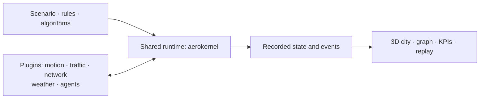

<p align="center"></p>

<p align="center"><b>Simulate a city's low-altitude drone businesses in 3D. Describe a scenario in one sentence: a model such as DeepSeek builds it, you confirm, and the simulation runs.</b></p>

<p align="center">
  <a href="https://github.com/ZhiweiWei-NAMI/AeroAgentSim/actions/workflows/tests.yml"></a>
  <a href="CHANGELOG.md"></a>
  
  <a href="LICENSE"></a>
</p>

https://github.com/user-attachments/assets/31cc139f-df4a-4ad1-9811-1c7c3758fd31

<p align="center"><i>One Chinese instruction → DeepSeek drafts the scenario → the user confirms → 6 of 6 orders delivered through a wind gust.</i><br><a href="docs/demos/deepseek-chinese-instruction/demo.mp4">Play the 58 s demo (MP4)</a> · <a href="docs/demos/deepseek-chinese-instruction/recording-full.mp4">Unedited 4.5 min recording</a> · <a href="docs/demos/deepseek-chinese-instruction/README.md">Transcript and logs</a></p>

## What it does

- **Build a scenario by describing it.** The assistant reads the platform's real templates, places and rules, proposes a plan, and changes nothing until you confirm. Works with any OpenAI-compatible model, including DeepSeek.
- **Nine ready-made worlds.** Parcel, medical and meal delivery, power-line inspection, crop spraying, air taxis, security patrol, a traffic accident and a shared city day.
- **See why things happen.** Change rules and algorithms, run again, and trace every result to recorded events in a 3D city with replay.

[Watch the incident and weather demo (88 s MP4)](docs/demos/incident-weather/demo.mp4): configure wind, rain, fog and dusk, follow a timed fire, replay its ending, and open the responding UAV's recorded photograph. [Screenshots, validation and limits](docs/demos/incident-weather/README.md).

## Start

Python 3.10+ and Node.js 22 with npm. No GPU, Docker or account needed.

**Assets:** the public clone bundles a real lightweight OSM Huangpu city; the base installation and all nine templates need no separate asset download. For detailed buildings and display models, optionally run `aeroagentsim assets fetch` after installation, then `aeroagentsim assets list` and reload the viewer. Pack `huangpu-city` **1.1.0** comes from Release [`assets-huangpu-city-v1.1`](https://github.com/ZhiweiWei-NAMI/AeroAgentSim/releases/tag/assets-huangpu-city-v1.1) (`huangpu-city-v1.1.zip`, about 123.2 MiB). Fetch verifies the archive SHA-256 and installation checks manifest file sizes. Packs live outside Git in `$XDG_DATA_HOME/aeroagentsim/assets`, default `~/.local/share/aeroagentsim/assets`; `AEROAGENTSIM_ASSETS_DIR` overrides it. OSM data is © OpenStreetMap contributors, ODbL 1.0; building mesh, texture and model terms come from the pack's `NOTICE.txt`. See [asset verification and licences](ASSETS.md) and [post-install checks](INSTALL.md#post-install-acceptance).

```bash
git clone https://github.com/ZhiweiWei-NAMI/AeroAgentSim.git && cd AeroAgentSim
python -m venv .venv && source .venv/bin/activate && python -m pip install -e ./aerokernel -e '.[server]'
(cd frontend && npm ci && npm run build) && aeroagentsim serve --frontend frontend/dist
```

Open <http://127.0.0.1:8002>. [Install](INSTALL.md) covers Windows shells, Chromium for camera capture and acceptance checks. [中文](README_CN.md)

To create your own region and objects, follow [Blank project → region → run](docs/guides/blank-project-tutorial.md). It links the [OSM map builder](tools/build_map.py) and the region API. Templates prefill example snapshots, coordinates, objects, rules and engines; arbitrary OSM data does not automatically create a complete simulation.

## Connect DeepSeek and try one sentence

1. Click **Describe a scenario in your own words** (or press <kbd>A</kbd>).
2. Enter endpoint `https://api.deepseek.com/v1`, a DeepSeek model such as `deepseek-chat`, and your API key, then press **Connect and test**.
3. Type:

   > 帮我搭一个外卖无人机配送仿真：3架无人机给6个订单送餐，中途刮一阵大风，仿真10分钟，看看能否全部送达。

4. Review the plan, answer its questions (for example "订单固定为 6 单，其余问题都用默认值。"), then **Confirm and apply → Initialize → Start**. The **Story** tab checks the plan against what actually happened.

The key stays on the server and is never sent back to the browser. To preset the model for everyone using this server:

```bash
AEROAGENTSIM_ASSISTANT_BASE_URL=https://api.deepseek.com/v1 AEROAGENTSIM_ASSISTANT_MODEL=deepseek-chat \
AEROAGENTSIM_ASSISTANT_API_KEY=sk-... aeroagentsim serve --frontend frontend/dist
```

No model? `aeroagentsim run-template parcel-delivery` opens a ready-made scenario: **Validate → Save version → Initialize → Start**. [Assistant guide](docs/guides/assistant.md) · [Six workbench walkthroughs](docs/media/README.md)

## Pick a scenario

Nine ready-made worlds, each with controls to change and KPIs to measure the result. Click a thumbnail for the scenario guide.

<table>
  <tr>
    <td align="center" width="25%"><a href="scenarios/templates/parcel-delivery/README.md"><br><b>Parcel delivery</b></a><br><code>parcel-delivery</code><br>Dispatch a fleet from two vertiports to customers across the district.</td>
    <td align="center" width="25%"><a href="scenarios/templates/medical-delivery/README.md"><br><b>Medical delivery</b></a><br><code>medical-delivery</code><br>Interrupt routine deliveries to carry urgent hospital supplies.</td>
    <td align="center" width="25%"><a href="scenarios/templates/powerline-inspection/README.md"><br><b>Power line inspection</b></a><br><code>powerline-inspection</code><br>Follow a survey route and record inspection observations.</td>
    <td align="center" width="25%"><a href="scenarios/templates/crop-spraying/README.md"><br><b>Crop spraying</b></a><br><code>crop-spraying</code><br>Treat a field in rows, swap batteries and pause in strong wind.</td>
  </tr>
  <tr>
    <td align="center"><a href="scenarios/templates/air-taxi/README.md"><br><b>Air taxi</b></a><br><code>air-taxi</code><br>Carry passengers between three vertiports.</td>
    <td align="center"><a href="scenarios/templates/security-patrol/README.md"><br><b>Security patrol</b></a><br><code>security-patrol</code><br>Patrol the district and respond to an operator-reported incident.</td>
    <td align="center"><a href="docs/examples/traffic-accident.md"><br><b>Traffic accident</b></a><br><code>traffic-accident</code><br>Assess an accident, choose a responder and upload a simulated camera image.</td>
    <td align="center"><a href="docs/examples/city-day.md"><br><b>One day in a shared city</b></a><br><code>city-day</code><br>Deliveries, inspections, air taxis and incident response interact.</td>
  </tr>

<tr><td align="center"><a href="scenarios/templates/food-delivery/README.md"><br><b>Restaurant meal delivery</b></a><br><code>food-delivery</code><br>Preparation, pickup, physical delivery, kitchen disruptions and on-time results.</td></tr>
</table>

Open any scenario with `aeroagentsim run-template <id>`. Each declares its own knobs; for example, `aeroagentsim run-template parcel-delivery --set fleet_size=12 --set wind_speed=8`. [Template guide](docs/guides/templates.md)

## Change a rule, watch the world change

*When a drone's battery drops below its reserve, send it to charge.* Battery reserve, no-fly zones, separation and wind limits are editable predicates and event chains. Change `battery_reserve` from 20 to 35 with `--set battery_reserve=35`, or edit the predicate in the configuration's Tasks section, then run again. With **Why?**, follow the recorded condition → chain → command → state change, alongside the drone in the 3D city. Replay lets you revisit the same moment.


[Edit the low-altitude rules](docs/guides/lowalt-rules.md) · [Write a predicate](docs/guides/predicates.md) · [Author an event chain](docs/guides/behaviours.md)

## Compare algorithms in one command

Swap task allocation, route planning, conflict resolution or charging through four algorithm slots, or supply your own `module:Class`. This compares three built-in allocators on the same three random seeds:

```bash
aeroagentsim experiment parcel-delivery --vary allocator=nearest,auction,hungarian --seeds 3 --jobs 3 --out runs
```

| Allocator | Tasks completed | Mean task latency (s) | Energy used (kJ) |
|---|---:|---:|---:|
| nearest | 9.7 ± 5.0 | 77.8 ± 30.9 | 229.5 ± 72.3 |
| auction | 10.0 ± 5.0 | 71.1 ± 22.2 | 224.1 ± 66.7 |
| hungarian | 10.0 ± 4.6 | 71.4 ± 18.5 | 225.2 ± 68.2 |

Measured on 2026-10-10 with the shipped parcel defaults: eight drones, 300 simulated seconds, seeds 0–2, nine runs. Values are **mean ± sample standard deviation**, with three observations per cell. Latency covers completed tasks; these three seeds do not establish a general winner. Raw tables and run links are saved under `runs/.experiments/<id>/` as `experiment.csv` and `experiment.md`.


[Algorithms](docs/guides/algorithms.md) · [Experiments](docs/guides/experiments.md)

## Many businesses, one sky

In **city-day**, parcel and medical deliveries, power line inspections, air taxis and road-incident responders share one city and one clock. An accident closes nearby airspace and changes delivery routes; urgent supplies interrupt parcel jobs; wind pauses inspections. The event feed explains what happened, and KPIs show the consequences.


[City-day walkthrough](docs/examples/city-day.md)

## Watch like a control tower

**Director** follows activity automatically; **Cinema** fills the view with the city and an event ticker. Select a drone for its task, next stop, battery and recent journey. Its status explains *why* it is holding, rerouting or returning to charge; click the explanation to inspect the recorded cause. Replay runs at 0.5–8× speed, with graph and city views on the same timeline.

Switch the controls, template descriptions and event feed with the **中文 / English** button. Workbench keys (without Shift): `Ctrl+K` / `⌘K` opens the command palette, `C` Configure, `A` Assistant, `R` Records, `G` relation graph, `F` follow the selected spatial entity, `I` Operate on an active live run, `L` Back to live, and `Space` play/pause recorded playback. From a live view, `Space` enters playback; use the top-bar Pause/Resume buttons to control the simulation. `Esc` closes the active overlay or selection; while editing, the first `Esc` leaves the field. Shortcuts respect text entry and dialogs. [Shortcut details](docs/guides/visualization.md#workbench-shortcuts).


## How it works



- **One clock.** Domain plugins and agents coordinate through one discrete-event runtime.
- **One writer per fact.** Algorithms propose actions; the owning engine executes commands and commits state.
- **Replay from the record.** Inspect recorded state and agent decisions without rerunning physics, cameras or model calls.
- **Typed by AeroGraph.** Define entities, relations and rules by type; shipped snapshots work without an AeroGraph checkout.

[Architecture](docs/concepts/architecture.md) · [Plugins and native simulators](docs/guides/plugins.md) · [Design notes](docs/design-notes.md)

## Where things live

The [repo map](docs/repo-map.md) connects scenarios, algorithms, rules, services and the console to their source directories, with reading routes for researchers and contributors.

---

[Docs](docs/README.md) · [Guides](docs/guides/README.md) · [Quickstart](docs/getting-started/quickstart.md) · [CLI](docs/reference/cli.md) · [Containers](docs/guides/containers.md) · [Changelog](CHANGELOG.md) · [中文](README_CN.md)

Contribute a scenario, algorithm or plugin: [Contributing](CONTRIBUTING.md). Code is licensed under [Apache-2.0](LICENSE); city data is © OpenStreetMap contributors, **ODbL 1.0** ([attribution](scenarios/demos/traffic-accident/inputs/lite-city/ATTRIBUTION.txt)).

See [asset terms and provenance](ASSETS.md) for the optional detailed pack described under Start.

Earlier AirFogSim code is preserved on [`archive/airfogsim`](https://github.com/ZhiweiWei-NAMI/AeroAgentSim/tree/archive/airfogsim); the earlier public package remains on PyPI as [1.1.1](https://pypi.org/project/aeroagentsim/1.1.1/).
