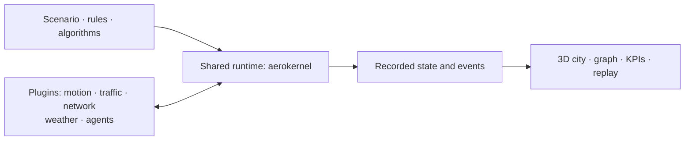

<p align="center"></p>

<p align="center"><b>Simulate a city's low-altitude businesses, change the rules and algorithms, and watch the consequences.</b></p>

<p align="center">
  <a href="https://github.com/ZhiweiWei-NAMI/AeroAgentSim/actions/workflows/tests.yml"></a>
  <a href="CHANGELOG.md"></a>
  
  <a href="LICENSE"></a>
</p>


<p align="center"></p>

## Try it in three commands

Python 3.10+ and Node.js 22 with npm. The parcel scenario needs no GPU, Docker or account.

```bash
git clone https://github.com/ZhiweiWei-NAMI/AeroAgentSim.git && cd AeroAgentSim
python -m venv .venv && source .venv/bin/activate && python -m pip install -e ./aerokernel -e '.[server]'
(cd frontend && npm ci && npm run build) && aeroagentsim run-template parcel-delivery
```

The last command opens an editable Studio workspace: choose **Validate & run → Validate → Run now**. Add `--headless` to run directly in the terminal. `aeroagentsim templates` lists all nine scenarios. [Install](docs/getting-started/install.md) covers Windows and Chromium setup for traffic-accident and city-day camera capture. [中文](README_CN.md)

## Pick a scenario

Nine ready-made worlds, each with controls to change and KPIs to measure the result. Click a thumbnail for the scenario guide.

<table>
  <tr>
    <td align="center" width="25%"><a href="scenarios/templates/parcel-delivery/README.md"><br><b>Parcel delivery</b></a><br><code>parcel-delivery</code><br>Dispatch a fleet from two vertiports to customers across the district.</td>
    <td align="center" width="25%"><a href="scenarios/templates/medical-delivery/README.md"><br><b>Medical delivery</b></a><br><code>medical-delivery</code><br>Interrupt routine deliveries to carry urgent hospital supplies.</td>
    <td align="center" width="25%"><a href="scenarios/templates/powerline-inspection/README.md"><br><b>Power line inspection</b></a><br><code>powerline-inspection</code><br>Follow a survey route and record inspection observations.</td>
    <td align="center" width="25%"><a href="scenarios/templates/crop-spraying/README.md"><br><b>Crop spraying</b></a><br><code>crop-spraying</code><br>Treat a field in rows, swap batteries and pause in strong wind.</td>
  </tr>
  <tr>
    <td align="center"><a href="scenarios/templates/air-taxi/README.md"><br><b>Air taxi</b></a><br><code>air-taxi</code><br>Carry passengers between three vertiports.</td>
    <td align="center"><a href="scenarios/templates/security-patrol/README.md"><br><b>Security patrol</b></a><br><code>security-patrol</code><br>Patrol the district and respond to an operator-reported incident.</td>
    <td align="center"><a href="docs/examples/traffic-accident.md"><br><b>Traffic accident</b></a><br><code>traffic-accident</code><br>Assess an accident, choose a responder and upload a simulated camera image.</td>
    <td align="center"><a href="docs/examples/city-day.md"><br><b>One day in a shared city</b></a><br><code>city-day</code><br>Deliveries, inspections, air taxis and incident response interact.</td>
  </tr>

<tr><td align="center"><a href="scenarios/templates/food-delivery/README.md"><br><b>Restaurant meal delivery</b></a><br><code>food-delivery</code><br>Preparation, pickup, physical delivery, kitchen disruptions and on-time results.</td></tr>
</table>

Open any scenario with `aeroagentsim run-template <id>`. Each declares its own knobs; for example, `aeroagentsim run-template parcel-delivery --set fleet_size=12 --set wind_speed=8`. [Template guide](docs/guides/templates.md)

## Change a rule, watch the world change

*When a drone's battery drops below its reserve, send it to charge.* Battery reserve, no-fly zones, separation and wind limits are editable predicates and event chains. Change `battery_reserve` from 20 to 35 with `--set battery_reserve=35`, or edit the predicate in Studio, then run again. In **Inspect**, follow the recorded condition → chain → command → state change, alongside the drone in the 3D city. Replay lets you revisit the same moment.


[Edit the low-altitude rules](docs/guides/lowalt-rules.md) · [Write a predicate](docs/guides/predicates.md) · [Author an event chain](docs/guides/behaviours.md)

## Compare algorithms in one command

Swap task allocation, route planning, conflict resolution or charging through four algorithm slots, or supply your own `module:Class`. This compares three built-in allocators on the same three random seeds:

```bash
aeroagentsim experiment parcel-delivery --vary allocator=nearest,auction,hungarian --seeds 3 --jobs 3 --out runs
```

| Allocator | Tasks completed | Mean task latency (s) | Energy used (kJ) |
|---|---:|---:|---:|
| nearest | 9.7 ± 5.0 | 77.8 ± 30.9 | 229.5 ± 72.3 |
| auction | 10.0 ± 5.0 | 71.1 ± 22.2 | 224.1 ± 66.7 |
| hungarian | 10.0 ± 4.6 | 71.4 ± 18.5 | 225.2 ± 68.2 |

Measured on 2026-10-10 with the shipped parcel defaults: eight drones, 300 simulated seconds, seeds 0–2, nine runs. Values are **mean ± sample standard deviation**, with three observations per cell. Latency covers completed tasks; these three seeds do not establish a general winner. Raw tables and run links are saved under `runs/.experiments/<id>/` as `experiment.csv` and `experiment.md`.


[Algorithms](docs/guides/algorithms.md) · [Experiments](docs/guides/experiments.md)

## Many businesses, one sky

In **city-day**, parcel and medical deliveries, power line inspections, air taxis and road-incident responders share one city and one clock. An accident closes nearby airspace and changes delivery routes; urgent supplies interrupt parcel jobs; wind pauses inspections. The event feed explains what happened, and KPIs show the consequences.


[City-day walkthrough](docs/examples/city-day.md)

## Watch like a control tower

**Director** follows activity automatically; **Cinema** fills the view with the city and an event ticker. Select a drone for its task, next stop, battery and recent journey. Its status explains *why* it is holding, rerouting or returning to charge; click the explanation to inspect the recorded cause. Replay runs at 0.5–8× speed, with graph and city views on the same timeline.

Switch the controls, template descriptions and event feed between **中文 / English**. In Simple view, use `D` for Director, `C` for cinema, `W` for the selected entity's latest event explanation and `L` for language; `?` shows all shortcuts.


## How it works



- **One clock.** Domain plugins and agents coordinate through one discrete-event runtime.
- **One writer per fact.** Algorithms propose actions; the owning engine executes commands and commits state.
- **Replay from the record.** Inspect recorded state and agent decisions without rerunning physics, cameras or model calls.
- **Typed by AeroGraph.** Define entities, relations and rules by type; shipped snapshots work without an AeroGraph checkout.

[Architecture](docs/concepts/architecture.md) · [Plugins and native simulators](docs/guides/plugins.md) · [Design notes](docs/design-notes.md)

## Where things live

The [repo map](docs/repo-map.md) connects scenarios, algorithms, rules, services and the console to their source directories, with reading routes for researchers and contributors.

---

[Docs](docs/README.md) · [Quickstart](docs/getting-started/quickstart.md) · [CLI](docs/reference/cli.md) · [Containers](docs/guides/containers.md) · [Changelog](CHANGELOG.md) · [中文](README_CN.md)

Contribute a scenario, algorithm or plugin: [Contributing](CONTRIBUTING.md). Code is licensed under [Apache-2.0](LICENSE); city data is © OpenStreetMap contributors, **ODbL 1.0** ([attribution](scenarios/demos/traffic-accident/inputs/lite-city/ATTRIBUTION.txt)).

The lightweight city is included. For detailed buildings and display models, run `aeroagentsim assets fetch` to install Huangpu city pack 1.1 from release tag [`assets-huangpu-city-v1.1`](https://github.com/ZhiweiWei-NAMI/AeroAgentSim/releases/tag/assets-huangpu-city-v1.1), then reload the viewer. The pack has its own `NOTICE.txt`; see [asset terms and provenance](ASSETS.md).

Earlier AirFogSim code is preserved on [`archive/airfogsim`](https://github.com/ZhiweiWei-NAMI/AeroAgentSim/tree/archive/airfogsim); the earlier public package remains on PyPI as [1.1.1](https://pypi.org/project/aeroagentsim/1.1.1/).
