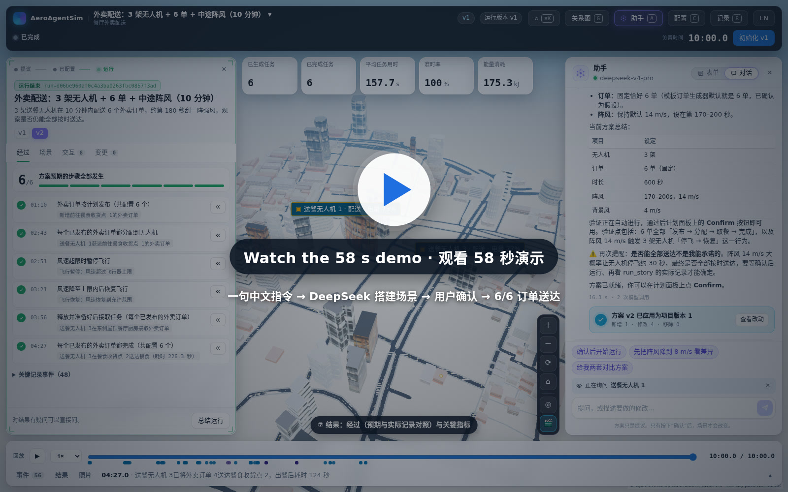
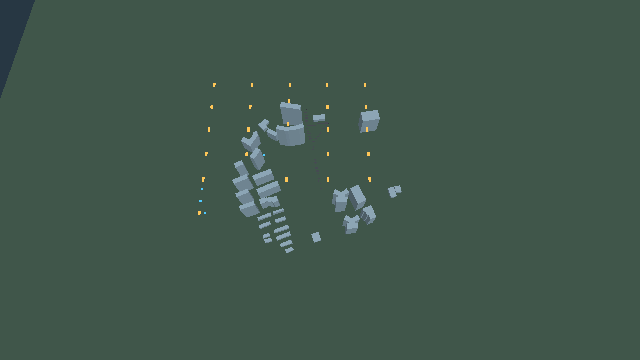
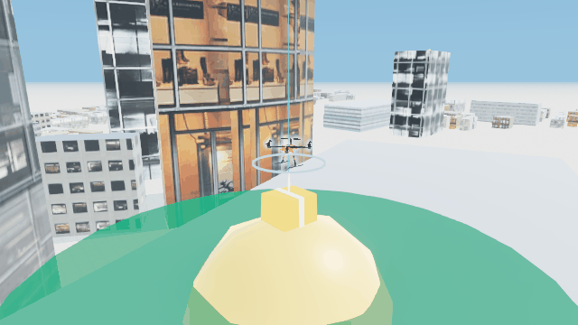
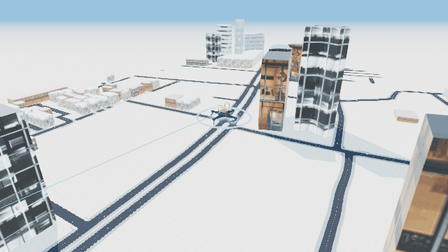
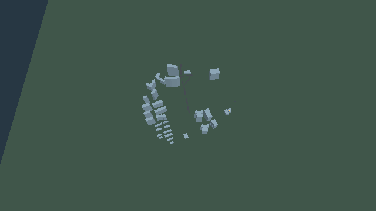
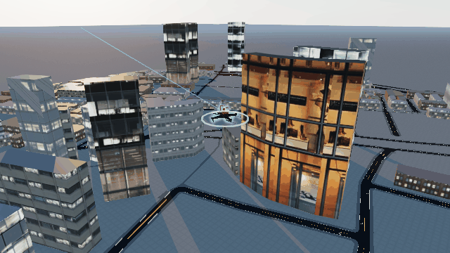
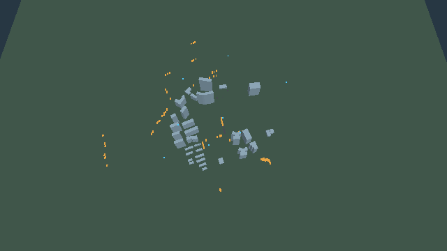
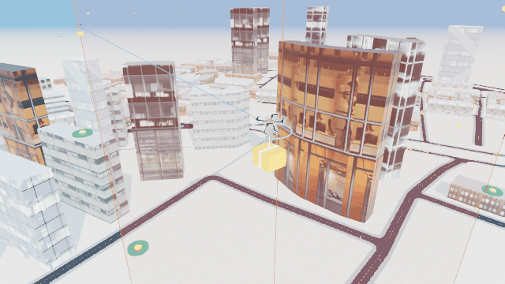
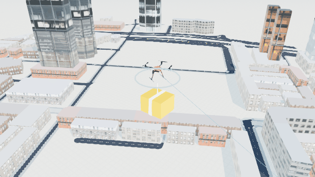
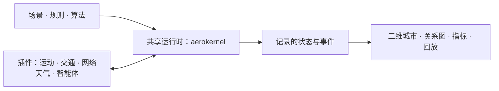

<p align="center"></p>

<p align="center"><b>在 3D 城市中模拟低空无人机业务。用一句话描述场景：DeepSeek 等大模型负责搭建，你确认后即可运行仿真。</b></p>

<p align="center">
  <a href="https://github.com/ZhiweiWei-NAMI/AeroAgentSim/actions/workflows/tests.yml"></a>
  <a href="CHANGELOG.md"></a>
  
  <a href="LICENSE"></a>
</p>

<p align="center"><a href="docs/demos/deepseek-chinese-instruction/demo.mp4"></a></p>

<p align="center"><i>一句中文指令 → DeepSeek 起草场景 → 用户确认 → 经历阵风后 6 单全部送达。</i><br><a href="docs/demos/deepseek-chinese-instruction/demo.mp4">播放 58 秒演示（MP4）</a> · <a href="docs/demos/deepseek-chinese-instruction/recording-full.mp4">未剪辑的 4.5 分钟录屏</a> · <a href="docs/demos/deepseek-chinese-instruction/README.md">对话记录与日志</a></p>

## 它能做什么

- **说一句话就能搭场景。** 助手读取平台真实的模板、地点和规则，给出方案；在你确认之前不会改动任何内容。支持任何 OpenAI 兼容接口的模型，包括 DeepSeek。
- **九个现成场景。** 包裹、医疗与外卖配送，电力巡检，农田喷洒，空中出租车，安防巡逻，交通事故，以及多业务共享的城市一天。
- **看清结果的原因。** 修改规则和算法后重新运行，在可回放的 3D 城市中把每个结果追溯到记录的事件。

## 开始

需要 Python 3.10+、Node.js 22 和 npm，无需 GPU、Docker 或账户。

**城市资源：**公开仓库自带真实的 OSM 黄浦轻量城市，基础安装和九个模板都不需要另行下载。需要精细建筑与展示模型时，安装后可选运行 `aeroagentsim assets fetch`，再用 `aeroagentsim assets list` 查看并重新加载视图。资源包 `huangpu-city` **1.1.0** 来自 Release [`assets-huangpu-city-v1.1`](https://github.com/ZhiweiWei-NAMI/AeroAgentSim/releases/tag/assets-huangpu-city-v1.1)（`huangpu-city-v1.1.zip`，约 123.2 MiB）。下载会校验归档 SHA-256，安装会核对清单文件大小。资源保存在 Git 仓库之外的 `$XDG_DATA_HOME/aeroagentsim/assets`，默认 `~/.local/share/aeroagentsim/assets`，可用 `AEROAGENTSIM_ASSETS_DIR` 更改。OSM 数据署名为 © OpenStreetMap contributors，采用 ODbL 1.0；建筑网格、纹理和展示模型的许可以资源包 `NOTICE.txt` 为准。详见[资源校验与许可](ASSETS.md)和[安装后验收](INSTALL.md#post-install-acceptance)。

```bash
git clone https://github.com/ZhiweiWei-NAMI/AeroAgentSim.git && cd AeroAgentSim
python -m venv .venv && source .venv/bin/activate && python -m pip install -e ./aerokernel -e '.[server]'
(cd frontend && npm ci && npm run build) && aeroagentsim serve --frontend frontend/dist
```

打开 <http://127.0.0.1:8002>。[安装指南](INSTALL.md) 包含 Windows 的两种终端、拍摄所需的 Chromium 配置与安装后验收。[English](README.md)

从自己的区域和对象开始，阅读[空白项目 → 区域 → 运行教程](docs/guides/blank-project-tutorial.zh-CN.md)，其中包含 [OSM 地图编译工具](tools/build_map.py)与区域 API 的入口。模板预先配置了示例快照、坐标、对象、规则和引擎；任意 OSM 地图不会自动成为完整仿真。

## 连接 DeepSeek，试一句话

1. 点击 **用你自己的话描述一个场景**（或按 <kbd>A</kbd>）。
2. 填写接口地址 `https://api.deepseek.com/v1`、DeepSeek 模型名（如 `deepseek-chat`）和 API 密钥，点击 **连接并测试**。
3. 输入：

   > 帮我搭一个外卖无人机配送仿真：3架无人机给6个订单送餐，中途刮一阵大风，仿真10分钟，看看能否全部送达。

4. 查看方案并回答它的问题（例如“订单固定为 6 单，其余问题都用默认值。”），然后依次 **确认并应用 → 初始化 → 启动**。**经过** 标签页会把方案预期与实际记录逐条对照。

密钥只保存在服务器上，不会返回浏览器。如需为这台服务器的所有用户预设模型：

```bash
AEROAGENTSIM_ASSISTANT_BASE_URL=https://api.deepseek.com/v1 AEROAGENTSIM_ASSISTANT_MODEL=deepseek-chat \
AEROAGENTSIM_ASSISTANT_API_KEY=sk-... aeroagentsim serve --frontend frontend/dist
```

不接模型？运行 `aeroagentsim run-template parcel-delivery` 打开现成场景，依次 **验证 → 保存版本 → 初始化 → 启动**。[助手指南](docs/guides/assistant.md) · [六段工作台演示](docs/media/README.md)

## 选择一个场景

九个可直接运行的场景，都有可调参数和用于衡量结果的指标（KPI）。点击缩略图查看场景说明。

<table>
  <tr>
    <td align="center" width="25%"><a href="scenarios/templates/parcel-delivery/README.md"><br><b>包裹配送</b></a><br><code>parcel-delivery</code><br>从两座垂直起降场调度机队，为街区内的客户配送包裹。</td>
    <td align="center" width="25%"><a href="scenarios/templates/medical-delivery/README.md"><br><b>医疗配送</b></a><br><code>medical-delivery</code><br>暂停常规配送，优先运送医院的紧急物资。</td>
    <td align="center" width="25%"><a href="scenarios/templates/powerline-inspection/README.md"><br><b>电力巡检</b></a><br><code>powerline-inspection</code><br>沿巡检航线飞行，记录观测结果。</td>
    <td align="center" width="25%"><a href="scenarios/templates/crop-spraying/README.md"><br><b>农田喷洒</b></a><br><code>crop-spraying</code><br>逐行喷洒农田、更换电池，并在大风时暂停作业。</td>
  </tr>
  <tr>
    <td align="center"><a href="scenarios/templates/air-taxi/README.md"><br><b>空中出租车</b></a><br><code>air-taxi</code><br>在三座垂直起降场之间运送乘客。</td>
    <td align="center"><a href="scenarios/templates/security-patrol/README.md"><br><b>安防巡逻</b></a><br><code>security-patrol</code><br>巡查街区，响应操作员上报的事件。</td>
    <td align="center"><a href="docs/examples/traffic-accident.md"><br><b>交通事故响应</b></a><br><code>traffic-accident</code><br>评估事故、选派响应机，拍摄并上传仿真相机图像。</td>
    <td align="center"><a href="docs/examples/city-day.md"><br><b>共享城市的一天</b></a><br><code>city-day</code><br>配送、巡检、空中出租车与事故响应相互影响。</td>
  </tr>

<tr><td align="center"><a href="scenarios/templates/food-delivery/README.md"><br><b>餐厅外卖配送</b></a><br><code>food-delivery</code><br>备餐、取餐、配送、延误干预与准时送达统计。</td></tr>
</table>

用 `aeroagentsim run-template <id>` 打开任意场景。各模板分别定义可调参数，例如：`aeroagentsim run-template parcel-delivery --set fleet_size=12 --set wind_speed=8`。[模板指南](docs/guides/templates.md)

## 改一条规则，看世界如何变化

*当无人机电量低于预留阈值时，让它返回充电。* 电量预留、禁飞区、安全间隔和风速限制都由可编辑的谓词与事件链表达。用 `--set battery_reserve=35` 将预留电量从 20% 改为 35%，或在配置的“任务”部分编辑谓词，再运行一次。通过 **为什么？**，沿着记录的条件 → 事件链 → 命令 → 状态变化追查原因，同时观察三维城市中的无人机。通过回放，可以反复查看同一时刻。


[修改低空运行规则](docs/guides/lowalt-rules.md) · [编写谓词](docs/guides/predicates.md) · [编写事件链](docs/guides/behaviours.md)

## 一条命令对比算法

任务分配、航线规划、冲突消解和充电策略各有独立的算法接口，也可以接入自己的 `module:Class`。下面用相同的三个随机种子对比三种内置分配算法：

```bash
aeroagentsim experiment parcel-delivery --vary allocator=nearest,auction,hungarian --seeds 3 --jobs 3 --out runs
```

| 分配算法 | 完成任务数 | 平均任务时延（秒） | 能量消耗（kJ） |
|---|---:|---:|---:|
| nearest | 9.7 ± 5.0 | 77.8 ± 30.9 | 229.5 ± 72.3 |
| auction | 10.0 ± 5.0 | 71.1 ± 22.2 | 224.1 ± 66.7 |
| hungarian | 10.0 ± 4.6 | 71.4 ± 18.5 | 225.2 ± 68.2 |

实测日期为 2026-10-10，采用随项目提供的包裹配送默认配置：8 架无人机、300 秒仿真时间、随机种子 0–2，共 9 次运行。数值为 **均值 ± 样本标准差**，每格含 3 个观测值。时延只统计已完成任务；这三个种子不足以证明哪种算法普遍更优。原始表格及运行链接保存在 `runs/.experiments/<id>/` 下的 `experiment.csv` 和 `experiment.md` 中。


[算法指南](docs/guides/algorithms.md) · [实验指南](docs/guides/experiments.md)

## 多种业务，同一片天空

在 **city-day** 中，包裹与医疗配送、电力巡检、空中出租车和道路事故响应共用一座城市、同一个时钟。事故关闭附近空域，配送航线随之改变；紧急物资打断包裹任务；大风使巡检暂停。事件流说明发生了什么，指标展示这些变化带来的结果。


[城市综合场景详解](docs/examples/city-day.md)

## 像塔台一样观察

**自动导播（Director）** 自动跟随业务活动，**影院模式（Cinema）** 让城市画面和事件字幕占据屏幕。选中一架无人机，即可查看任务、下一站、电量和近期历程。状态说明会解释它*为什么*正在等待、绕行或返回充电；点击说明可查看记录中的原因。回放支持 0.5–8 倍速，关系图与城市画面始终使用同一条时间线。

用 **中文 / English** 按钮切换控件、模板说明和事件流的语言。工作台快捷键（不按 Shift）：`Ctrl+K` / `⌘K` 打开命令面板，`C` 配置，`A` 助手，`R` 运行记录，`G` 关系图，`F` 跟随选中的空间实体，`I` 操作当前实时运行，`L` 返回实时，`Space` 播放／暂停记录回放。在实时视图按 `Space` 会进入回放；暂停／恢复仿真使用顶部按钮。`Esc` 关闭当前浮层或取消选择；编辑时第一次 `Esc` 离开输入框。输入文字和使用对话框时，快捷键受限。详见[快捷键说明](docs/guides/visualization.md#workbench-shortcuts)。


## 工作原理



- **统一时钟。** 各领域插件与智能体通过同一个离散事件运行时协作。
- **每个事实只有一个写入者。** 算法提出动作，由负责该状态的引擎执行命令并提交结果。
- **从记录回放。** 查看已记录的状态和智能体决策，无需重新运行物理仿真、相机或模型调用。
- **AeroGraph 类型系统。** 按类型定义实体、关系与规则；项目自带的快照无需另行安装 AeroGraph。

[架构](docs/concepts/architecture.md) · [插件与原生仿真器](docs/guides/plugins.md) · [设计说明](docs/design-notes.md)

## 代码在哪里

[代码地图](docs/repo-map.md) 标出场景、算法、规则、服务与控制台对应的源码目录，并为研究者和贡献者提供阅读路线。

---

[文档](docs/README.md) · [指南索引](docs/guides/README.md) · [快速开始](docs/getting-started/quickstart.md) · [命令行](docs/reference/cli.md) · [容器](docs/guides/containers.md) · [更新日志](CHANGELOG.md) · [English](README.md)

欢迎贡献场景、算法或插件，详见[贡献指南](CONTRIBUTING.md)。代码采用 [Apache-2.0](LICENSE) 许可证；城市数据署名为 © OpenStreetMap contributors，采用 **ODbL 1.0** 许可（[署名说明](scenarios/demos/traffic-accident/inputs/lite-city/ATTRIBUTION.txt)）。

“开始”中的精细资源包为可选安装，详见[资源条款与来源](ASSETS.md)。

早期 AirFogSim 代码保留在 [`archive/airfogsim`](https://github.com/ZhiweiWei-NAMI/AeroAgentSim/tree/archive/airfogsim) 分支；此前发布的软件包仍可从 PyPI 获取：[1.1.1](https://pypi.org/project/aeroagentsim/1.1.1/)。
