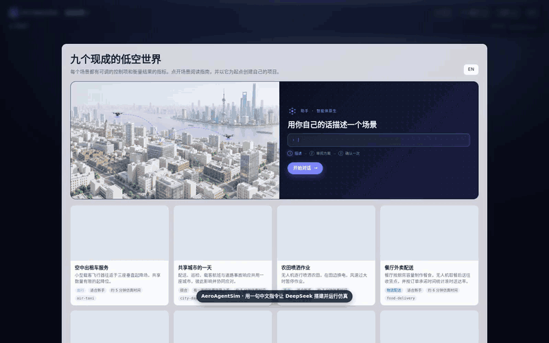

# Demo: one Chinese instruction, configured by DeepSeek, run in AeroAgentSim

演示：一句中文指令，由 DeepSeek 配置场景，在 AeroAgentSim 中运行成功。

<p align="center"></p>

[Full recording, real time, 4 min 31 s](recording-full.mp4) · [Highlights, sped up, 58 s](recording-highlights.mp4) · [Transcript](transcript.md) · [Screenshots](screenshots/)

## What happens

The user connects DeepSeek in the assistant panel and types one instruction:

> 帮我搭一个外卖无人机配送仿真：3架无人机给6个订单送餐，中途刮一阵大风，仿真10分钟，看看能否全部送达。

| Time | Step | Who |
|---:|---|---|
| 0:00 | Open the workbench, choose **Describe a scenario in your own words** | User |
| 0:25 | Enter endpoint and model, **Connect and test** → light turns green | User |
| 1:02 | Send the instruction above | User |
| 1:36 | Plan v1 ready: start from `food-delivery`, 3 meal drones, 600 s, 14 m/s gust at 170–200 s; the simulator validates it. DeepSeek took 31 s and 4 model calls, and asked 2 questions (exact 6 orders? gust strength?) | DeepSeek |
| 2:09 | Reply: 订单固定为 6 单，其余问题都用默认值。 | User (confirmation) |
| 2:26 | Plan v2 ready and validated | DeepSeek |
| 2:39 | **Confirm and apply**: the plan becomes project version 1 | User (confirmation) |
| 2:45 | **Initialize** (t = 0), then **Start** at 10× | User |
| 4:00 | Run completed: 10 simulated minutes | Simulator |
| 4:21 | **Story** tab and KPIs show the result | — |

Nothing in the project changes before **Confirm and apply**. The caption pill at the bottom of the video is a recording overlay, not part of the product.

## Result

All 6 meal orders were delivered on time, and the gust paused all 3 drones until the wind dropped.

| KPI | Value |
|---|---:|
| Orders created / completed | 6 / 6 |
| On-time rate | 100 % |
| Mean delivery time | 157.7 s |
| Weather holds (paused, then resumed) | 3 |
| Energy used | 175.3 kJ |
| Distance flown | 5.88 km |

| Planned step (Story tab) | Recorded |
|---|---|
| 外卖订单按计划发布（共配置 6 个） | 6/6, all by 01:10 |
| 每个已发布的外卖订单都分配到无人机 | 6/6, all by 02:43 |
| 释放并准备好后接取任务 | 6/6, all by 03:56 |
| 每个已发布的外卖订单都完成 | 6/6, all by 04:27 |
| 风速超限时暂停飞行 | 3/3 at 02:51 |
| 风速降至上限内后恢复飞行 | 3/3 at 03:21 |

The six orders are the template's six order slots, released at random times (0.075 orders/s); all six arrived in the first 70 s. DeepSeek described them as "fixed at exactly 6", which is true of the count but not of the release times.

## Setup used

| | |
|---|---|
| AeroAgentSim | commit `ed3966a` on `main`, frontend built from the same tree |
| Model | `deepseek-v4-pro` through a local OpenAI-compatible gateway at `http://127.0.0.1:8788/v1` (no key needed there) |
| Browser | Chromium 1248 via Playwright, 1600 × 1000, Chinese UI |
| Date | 2026-10-12 |

With DeepSeek's own API, use endpoint `https://api.deepseek.com/v1`, a DeepSeek chat model name such as `deepseek-chat`, and your API key. The key is stored on the server with owner-only permissions and never returned to the browser.

## Files

| Path | Contents |
|---|---|
| `demo.gif`, `recording-highlights.mp4`, `recording-full.mp4` | The recording: README GIF, 58 s cut, unedited 4 min 31 s |
| `screenshots/` | 16 frames, one per step |
| `transcript.md` | Conversation, each plan version with its operations, assumptions and questions, and the result |
| `logs/steps.jsonl`, `logs/recorder.log` | Recorder steps with timestamps |
| `logs/server.log` | AeroAgentSim server log for the whole session |
| `logs/assistant-session.json` | Full session: model messages, tool calls and results, events, plans |
| `logs/model-connection.json` | Endpoint, model and connection test result (no key) |
| `logs/plans/v1`, `logs/plans/v2` | Compiled scenario, compile report and simulator validation for each plan |
| `logs/run/` | Run metadata with KPIs, Story, manifest, scenario and the gzipped event journal |
| `record.mjs`, `transcript.py` | Scripts that produced the recording and the transcript |

The run's `viewer-index.sqlite3` is omitted: it is rebuilt from the journal.

## Reproduce

```bash
# 1. Server without a preset model, so the recording shows the connection step
aeroagentsim serve --out /tmp/demo-runs --frontend frontend/dist --port 18972

# 2. Record (uses the frontend's Playwright; DEEPSEEK_API_KEY is typed into the form if set)
DEEPSEEK_API_KEY=... node docs/demos/deepseek-chinese-instruction/record.mjs \
  --app http://127.0.0.1:18972 --endpoint https://api.deepseek.com/v1 --model deepseek-chat \
  --out /tmp/demo-output

# 3. Copy the session, run and logs into logs/, then
python docs/demos/deepseek-chinese-instruction/transcript.py
```

Model output varies between runs. Earlier takes found three platform issues, all fixed before this recording:

- DeepSeek added new customers after the orders that used them, so the plan failed to compile. New places are now applied first.
- When DeepSeek kept calling tools after its tool budget ran out, the turn ended with no reply. The turn now closes with a summary of the plan.
- DeepSeek lowered the order rate, so only 2 of 6 orders arrived. The scene now states how many random orders will actually arrive.
