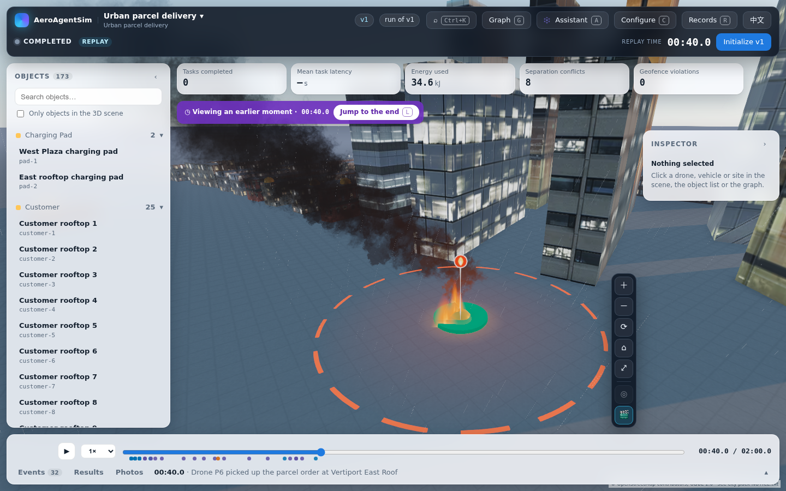

# Incident and weather workbench demo

[Play the 88 s MP4](demo.mp4)



The recording uses the real workbench forms, simulation, journal replay and
browser-rendered UAV photographs. It shows weather authoring, incident
authoring, draft preview, a live run, a slow orbit and close-up, the ended fire
in replay, the incident photograph, and the Chinese interface. Long loading
waits were removed; the retained footage and camera motion run at their
recorded pace. The cuts are listed in [recording metadata](logs/demo-metadata.json).

## Try it

1. Create **One day in a shared city** from the gallery.
2. In **Configure → Execution components**, set background wind to **6 m/s,
   from north-west**, rain to **4 mm/h**, visibility to **Mist · 2 km**, and
   light to **Dusk**. Preview and confirm each change.
3. In **Tasks & behaviours → Incidents**, add a **Fire**, with position
   `-13.05,-100.037,0`, radius **30 m**, start **20 s**, and end **100 s**.
4. Preview the draft, then **Validate → Save version → Initialize → Start**.
   Set the duration to at least 120 s to replay both activation and ending.
   Configure an incident watcher and responder to obtain a UAV photograph.

The recording uses `drone-3` as its watcher and disables the responder's
replacement requirement through the existing execution-component editor.
No second configuration system or demonstration-only scene is introduced.

## What changed

- Fire has a restrained flame, charcoal smoke plume, location pin and affected
  radius. Emission and ending follow committed incident state and simulation
  time; replay and UAV captures use the viewed source cut.
- Wind direction uses the meteorological **from** convention. Gust cues follow
  authored intervals. Rain, visibility and light use the existing environment
  entity, field declarations and AeroGraph metadata.
- Configuration offers staged weather summaries and draft preview. The
  conditions HUD and labels use the existing English and Chinese interface.
- UAV photographs include scene effects and exclude operator pins, labels and
  affected-area rings. [Recorded incident photograph](incident-photograph.png).

Wind and gusts affect the existing flight-hold and energy logic. Smoke,
flames, rain, visibility and light are presentation effects; they do not
simulate combustion, smoke transport or changes to sensing and task outcomes.
At an overview distance, an 800 m fog setting attenuates the smoke plume;
the incident pin and radius remain the location cues. The movie uses 2 km
visibility, while the separate close/ended screenshots exercise 800 m fog.

## Validation and performance

Implementation revision: `9fa2ff9333d1585094439bba582b74b5b99628d2`.
The final integration pass completed on 2026-10-14; its evidence was preserved
and reviewed when finishing the interrupted delivery.

Delivery review also repaired four boundary cases: duration edits on an
already-authored incident, direct-scenario end times beyond the run horizon,
pending incidents at their bootstrap timestamp, and an active fire lighting
another fire's ended plume through shared material uniforms. Targeted follow-up
checks passed **65 backend regressions** and **102 frontend regressions**, including
the shared-material draw and storage guards. Typecheck and the production build
also passed. The corrected end-to-end flow passed with the installed Chromium
configuration. A final HUD layout adjustment lets condition groups wrap when
the Objects and Inspector panels narrow the scene, preventing text collisions.
These results supplement the earlier full-suite evidence below;
the MP4 preserves the original integration recording.

| Check | Result |
|---|---|
| Application Python | 1,577 passed, 6 skipped, 3 LLM tests deselected |
| Kernel | 565 passed, 2 skipped |
| Frontend | 1,127 passed in 152 files; typecheck and build passed |
| Conditions end-to-end flow | Passed on rerun; the initial attempt exceeded the 90 s live-run deadline |
| Visual review | 7 views, including high/low quality, overview, ended incident and draft configuration |
| Browser, shader and WebGL errors | None in the recorded final validation |

The rerun kept the same assertions and deadlines. See [suite counts](logs/suite-counts.json),
the JUnit reports in `logs/`, and the end-to-end logs. The regression flow is
[conditions.spec.ts](../../../frontend/e2e/conditions.spec.ts).

The Astra performance pass reduced added atmosphere draws from **30 to 7**
at high/medium quality and **10 to 7** at low quality, including pin/leader.
Each fire uses three effect draws; rain and wind use one each. In the high
quality SwiftShader samples, conditions derivation fell from **0.126 to
0.031 ms**. Paused scenes added no draws. These were shared-host software
rendering measurements, not hardware GPU throughput estimates. JavaScript
allocations remain above zero, and medium-quality captures were slower in
the five-sample measurements. [Measurement details](logs/performance.json).

The pre-existing private-camera-console temporary-directory leak remains in
[`committed.py`](../../../src/aeroagentsim/observations/committed.py).
It is outside this presentation change.

## Evidence

- [Draft configuration](screenshots/draft-configure.png),
  [close fire](screenshots/fire-close.png),
  [ended fire](screenshots/fire-ended.png).
- [UAV photograph](incident-photograph.png) and its
  [capture request and source cut](logs/incident-photograph.json).
- The delivery rerun's [UAV photograph](delivery-incident-photograph.png),
  [ended replay](screenshots/delivery-ended.png), and
  [HUD with both side panels open](screenshots/delivery-hud.png).
- [Movie validation](logs/video-validation.json),
  [browser errors](logs/browser-errors.json), and [artifact checksums](logs/artifacts.json).
- Compressed source scenario and journal, manifest and committed prefix in
  `logs/run/` preserve the actual recorded run. Raw source data and bilingual
  product labels retain their original contents.

After building the frontend, rerun the existing regression flow from `frontend/`:

```bash
AEROAGENTSIM_CHROMIUM=/absolute/path/to/chromium \
AEROAGENTSIM_E2E_ROOT=/tmp/aas-conditions-check \
AEROAGENTSIM_E2E_PORT=4191 npx playwright test e2e/conditions.spec.ts
```

Set the Chromium path to an installed executable as described in
[camera setup](../../../INSTALL.md). The delivery rerun initially omitted this
environment setting and failed camera configuration during cooperation
preview; that attempt is retained in `logs/delivery-e2e-unconfigured-browser.log`.
