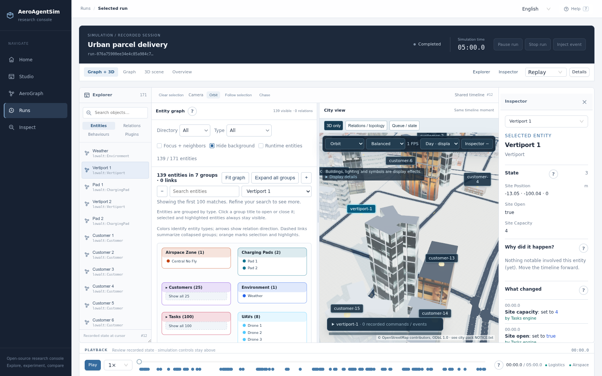
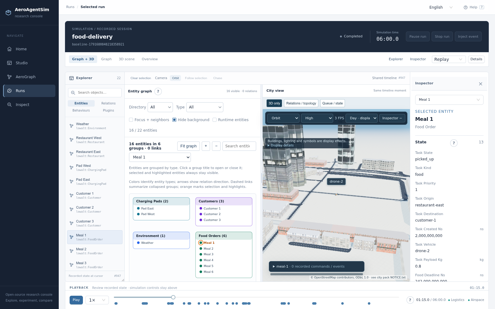

# Operational workbench delivery — 2026-10-11

AeroAgentSim keeps AeroGraph's schema and the independent aerokernel runtime.
The console now starts with saved workspaces and runs, then provides a shared
graph, detailed Huangpu city, searchable explorer, contextual inspector and
recorded timeline. Runtime controls and replay playback have separate controls.



## Start and access

From the repository root, after the installation steps in
[Install](../getting-started/install.md):

```bash
source .venv/bin/activate
export AEROAGENTSIM_AEROGRAPH_ROOT=/mnt/data2/weizhiwei/AeroGraph
aeroagentsim serve --out runs --frontend frontend/dist --host 0.0.0.0 --port 18923
```

Open <http://127.0.0.1:18923>. On another computer, forward the server's port
18923 to local port 18923 with SSH and open the same URL. The source-tree setting
is optional for standalone snapshot scenarios; use your actual AeroGraph path.
For a directly exposed console, configure `AEROAGENTSIM_CONSOLE_URL` to its real
origin as described in the installation guide.

The server already has Huangpu city pack 1.1 installed in the user asset cache.
For another machine, run `aeroagentsim assets fetch`; all 481 installed files
(148,811,213 bytes) were checked against the manifest. The rendered scene uses
414 building models, shared textures and the pack's entity models. Heavy viewers
and assets load after the working shell; buildings appear in batches. Asset
responses revalidate the installed file with ETags and return 304 when unchanged,
so a cached download is reused without hiding a pack update.

## Reusable workflows

**Food delivery:** Home → Restaurant meal delivery → Customize → Interactive →
Open in Studio. Configure the kitchens, order generators and couriers; save,
validate and run. Inject `restaurant_delay` with `restaurant-east` and `60`
seconds while that kitchen is preparing. The typed admission and execution
records identify the affected orders. Scheduled mode completes unattended;
interactive mode waits indefinitely when the operator disconnects.



**Traffic accident:** load the traffic template. The scripted and configured
live runs both executed accident reporting, bidding, award, photography and
upload. Alpha kept its noninterruptible medical task; Bravo completed the
incident capture. The live run used the configured `glm-5.3-flashx` provider:
four actual model calls, including one recorded correction. Journal replay
matched 4,088 scripted and 4,018 live records without model or engine calls.

Retained server results are in `runs/scripted`, `runs/live-raw-json`,
`runs/baseline-1791680848218358921` and
`runs/restaurant-delay-1791680896004756290`. The two food runs deliver all six
orders; the same 60-second kitchen disruption changes on-time deliveries from
5/6 to 3/6 and mean latency from 169.83 to 187.50 seconds. Their final 150 facts
match replay. Journals and real captures are preserved unchanged.

## Measured loading and rendering

Measurements use the same parcel run, 1600 × 1000 viewport, Med quality, camera
and server-side Chromium/SwiftShader. The before/after loading comparison uses
the same fresh browser-context protocol; these are individual observations,
not a statistical benchmark.

| Measurement | Before, cold | Delivered, cold | Delivered, warm |
| --- | ---: | ---: | ---: |
| Workbench visible | 6.529 s | 3.248 s | 1.464 s |
| All 414 buildings ready | 44.547 s | 12.740 s | 11.464 s |
| Scene draw calls | 928 | 160 | 160 |
| Renderer textures | 527 | 98 | 98 |

A separate check used a new persistent browser profile to measure ordinary disk
HTTP caching. City/entity asset transfer fell from 104,292,237 to 127,800 bytes
on reload: 425 successful asset responses became 425 conditional 304 responses,
while the decoded asset bytes and rendered scene stayed identical. Full-page
transfer was 133,281,827 bytes cold and 27,449,884 bytes warm; recorded run data
still transfers. City readiness in that profile was 11.739 / 10.084 seconds.
The older baseline had a truncated resource buffer, so it cannot support a
before/after bandwidth comparison.

The delivered scene rendered 4.15 / 4.76 FPS during ten seconds of actual replay
in the comparison browser. This is the software renderer's measured rate,
not the reciprocal of JavaScript submission time. The earlier final UI audit
measured search at 32 ms and view switching at 592–643 ms. The final browser
passes reported no JavaScript errors. Hardware-GPU frame performance remains
unmeasured.

## Verification and limits

The built console was exercised through template customization, saved draft
reopening, revision validation, run launch, entity search and selection, split
resizing, view modes, linked inspection, timeline seek, playback and language
switching. Runtime pause, refresh, typed injection, resume, reconnect and stop
were checked against the server's actual source watermark and status. A 1,000-entity
run also passed search, selection and the 1024-pixel layout check. The existing
frontend suite passed 457 tests; 17 targeted checks and TypeScript checking passed
after the final control/reconnection changes. The production Vite build and
changed backend configuration, authoring, feed, template and thumbnail checks
passed. All 376 local documentation links resolve.

Workspace edits increment a persisted revision only when content changes.
Validation is tied to that revision; stale writes return a conflict. Runs store
the source revision and their exact pinned configuration digest. Configuration
validation checks bindings and plugin configuration without starting or resetting
external simulators.

Journal/control streams reconnect automatically. An asset download interrupted
during initial city loading currently needs a page refresh to retry; its error
is kept visible rather than replaced with an untextured success.

Native SUMO/PX4 profiles still require external services and configuration; those
services were not launched for this delivery. Browser rendering measurements use
Chromium with SwiftShader on the server, not a hardware GPU benchmark. Live model
operation needs an explicitly configured provider; recorded replay needs none.
